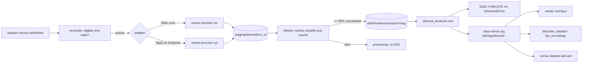

> **STATUS: HISTORICAL (superseded in part).** The first design cut, written 2026-10-12 before the owner's decisions of the same day. [`../first-party-processing-design.md`](../first-party-processing-design.md) (v2) supersedes it except where v2 says "as v1" or cites a v1 section (for example the section A inventory and the H gap numbering). Read v2 first.

# NEMAR first-party processing: design and epic breakdown

**Status:** research and design, 2026-10-12. Nothing in this document has been filed, branched, or implemented.
**Author:** lead-architect pass over nemar-cli, eegprep, signalJourney, NEMAR-pipeline, the website, the viewers, and the documentation site.
**Reading rule:** every statement about the current state carries a tag:
`(verified: path or command)`, `(inferred)`, or `(unknown)`.
Where an Architecture Decision Record (ADR) and any other document disagree, the ADR wins; this document follows that rule and says so where it bites.

---

## Executive summary

**The product in plain words.**
For every public dataset NEMAR hosts, NEMAR itself runs a declared, versioned cleaning recipe with eegprep inside a digest-pinned container,
and publishes the *results of the decisions* rather than a second copy of the data:
which channels are bad, which time segments are bad, what the line noise looked like and how it was removed,
the Adaptive Subspace Reconstruction (ASR) calibration state, the Independent Component Analysis (ICA) unmixing matrix, the ICLabel probabilities,
and quality metrics, each with a signalJourney provenance record that names the exact raw version, engine, image digest, recipe version and seeds.
Any consumer (the viewer, EEGDash, a notebook, an agent) re-applies those decisions to the raw bytes it already streams,
so a cleaned signal is derivable on demand, never stored by default.
The whole set for one dataset version is a *derived product*, served by the data plane under its own capability list, keyed to the dataset version it came from,
and citable with its own Digital Object Identifier (DOI) once it has passed quality gates.

**The five decisions that matter most.**

1. **State, not copies.** Store non-destructive annotations and model state per recording; do not materialize a cleaned signal in the first two years.
   This keeps storage at roughly 50 to 100 GB for the whole catalog instead of another 64 TiB, sidesteps the 26 no-derivatives licenses, and makes every consumer honest about what "cleaned" means.
2. **The Zarr serving copy is the precedent, not the git repository.** Products live in S3 at `<id>/derivatives/<recipe>/<recipe_version>/<dataset version>/` with their own manifest as the capability list, served by `data.nemar.org`.
   Nothing is committed to dataset repositories, so no dataset version is bumped and no DOI is minted by a NEMAR re-run (ADR 0006), and the shared GitHub organization is never touched.
3. **One recipe with declared adaptive rules, not many recipes.** `nemar-floor` is the minimum every eligible recording gets; `nemar-ica` adds ASR and ICA where the recording qualifies.
   Adaptivity is a set of rules evaluated per recording from measured facts, and the *resolved plan* is written into the provenance record, so variants are records, not forks.
4. **A derived DOI is a separate identifier with explicit relations, minted late.** The "original DOI plus a dash" idea is syntactically legal and semantically empty: resolvers infer nothing from a suffix.
   Mint a derived concept DOI per (dataset, recipe) and a version DOI per published product, with `IsDerivedFrom` to the source version DOI, NEMAR as organizational creator, the original authors as `DataCollector` contributors, and the source license inherited.
   Mint nothing until a product passes its quality gate, and never for an anonymous deposit.
5. **The runner is runtime-agnostic and the Worker never computes.** One container, one command line, three adapters (Hallu cron today, Tapis on Expanse next, Kubernetes or cloud burst if ever needed).
   This supersedes the sentence in ADR 0049 that says NEMAR "does not run it for them"; it keeps the sentence that says no job runner lives in the Worker.

**The three biggest gaps.**

1. **eegprep has no line-noise removal.** No CleanLine, no Zapline; only a FIR notch and a channel-rejection criterion (verified, section A).
   The owner's instinct about CleanLine is right about the need and wrong about availability.
   The cheapest license-clean close is a ZapLine plugin ported from BSD-3 `meegkit` with Zapline-plus's adaptive rules reimplemented from the paper; CleanLine (GPL-2) and Zapline-plus (GPL-3) cannot be ported into BSD eegprep as they stand.
   A related finding: eegprep's `clean_rawdata` port (ASR) descends from a GPL-3 plugin while eegprep is BSD-2, which needs a licensing decision before NEMAR distributes images built on it.
2. **eegprep's extension mechanism is a GUI menu registry, not a headless pipeline hook.** No parameter schema, no `pipeline` step for extensions, no provenance stamping, zero third-party extensions on PyPI (verified).
   A server pipeline can call plugin functions directly today; attaching plugins "as extensions" needs a small new contract in eegprep first.
3. **Nothing on the platform can serve a derived product yet.** The data plane brokers git-tracked files only (ADR 0066), the Zarr copy is latest-only (keyed to HEAD, not a version), there is no derivatives prefix in S3, and `compute_jobs`, the pipeline registry and the Tapis adapter from #1585 exist only as an issue (verified).
   The compute cost is also larger than #1585's estimate once channel count is weighed: tens of thousands of core-hours with Picard and rank reduction, well over a hundred thousand with extended Infomax on high-density recordings (section B).

---

## A. Inventory: what exists and works today versus what is claimed or planned

### A.1 eegprep (engine)

Source of truth: `sccn/eegprep` at `origin/develop` (`beef5a0d`); the local checkout is 85 commits behind and was not used (verified: `git rev-list --count HEAD..origin/develop`).

| Area | State | Evidence |
|---|---|---|
| Release | `__version__ = "0.4.0"`, released 2026-09-23, on PyPI; `requires-python >= 3.12` | verified: `src/eegprep/__init__.py`, PyPI JSON |
| License | `LICENSE` is BSD 2-Clause (SCCN 2025); README badge and `eegprep-lean` say BSD-3-Clause | verified; the mismatch is a gap (H) |
| Headless CLI | `eegprep {filter,rereference,resample,clean,epoch,ica,qc,report,pipeline,batch,bids,...}` with `--json`, stable error codes, `eegprep.manifest.v2` manifests | verified: `src/eegprep/cli/` |
| Declarative recipe | YAML, `schema_version: eegprep.pipeline.v1`, closed step enum `filter, rereference, resample, clean, epoch, ica, qc, report`; unknown step raises `COMMAND_NOT_IMPLEMENTED` | verified: `cli/commands/pipeline.py` L33-42, L462-492 |
| BIDS batch | `bids_preproc` (plugins/EEG_BIDS) loops per recording with `multiprocessing.Pool`, writes `derivatives/eegprep/` with `dataset_description.json` (`GeneratedBy`, `SourceDatasets`) and `desc-cleaned`, `desc-picard`, `desc-iclabel`, `desc-report` outputs; `GeneratedBy.Version` is the git commit of the install dir, empty for a wheel | verified: `bids_preproc.py` L477, L1228-1237 |
| Version stamping | CLI manifests stamp `eegprep_version`, Python, platform, numpy and BLAS (`math_backend_info`); scipy version is not stamped; extension versions are not stamped | verified: `cli/core.py` L224-233 |
| ICA algorithms | `pop_runica` dispatches `runica` (Infomax, extended default on), `picard` (python-picard 0.8, Picard-O), `runamica15` (external Fortran binary, excluded from wheels). FastICA/SOBI/JADE raise `NotImplementedError` | verified: `popfunc/pop_runica.py` L23-29, L407-422 |
| Seeds | runica: `seed` kwarg, default `RandomState(5489)` (MATLAB default) unless `rndreset='on'`; Picard: identity `w_init` unless `random_state` given (honored since PR #438); RANSAC `RandomState(5489)` | verified |
| Determinism | float64 throughout ICA and ASR; no thread pinning except `bids_preproc` (threadpoolctl); docs say results are "reproducible per platform pair rather than universally" | verified: `development.rst` L895-909 |
| Benchmarks | 64 ch x 60 s at 250 Hz, one BLAS thread, 512 iterations, synthetic data: runica 84.9 s native, Picard 6.8 s native (neither converged, as expected on noise). No per-recording benchmarks on real data | verified: `origin/epic/324-pyodide-browser:docs/source/pyodide_benchmark.md` |
| ASR | `asr_calibrate` returns the state dict `{M, T, B, A, sos, iir_state, ...}`; `asr_process` takes and returns state; **`clean_asr` and `clean_artifacts` discard it** and write nothing to `EEG.etc`; sampling rate is not part of the state | verified: `clean_asr.py` L194, L209-213 |
| Masks | `EEG.etc.clean_channel_mask` (True = kept), `EEG.etc.clean_sample_mask`, `EEG.etc.clean_drifts_kernel`; boundary events after `eeg_eegrej` | verified |
| ICLabel | PyTorch model loaded from `netICL.mat` (10.8 MB) at call time; `torch` is an optional extra; CPU only; output `EEG.etc.ic_classification.ICLabel.classifications` (n x 7). **No license text for the weights in the repo.** ONNX export (#377) closed but not on `develop`; int8 model exists only on the epic branch | verified |
| Line noise | **No CleanLine, no Zapline.** `git grep -i cleanline origin/develop` has one hit, the word "cleanliness" in a skill file; `zapline` has zero. Available: `pop_eegfiltnew(revfilt=True)` band-stop FIR (`eegprep filter --notch`), `clean_channels(noise_threshold)` as a *rejection* criterion, an internal notch in `clean_channels_nolocs` | verified |
| Extensions | Entry-point group `eegprep.extensions`, API version `"1"`, prefix `eegprep-ext-`, `register() -> ExtensionSpec` with `pop_functions`/`actions`/`menus`; callables follow `fn(EEG, ..., return_com=False)`; **no parameter schema, no headless `run_extension`, no pipeline step, no sandbox, no signature check**; curation is "a review signal, not a sandbox"; shipped catalog is empty; **no `eegprep-ext-*` package on PyPI** | verified: `extensions.py`, `extension_curation.rst`, PyPI simple index |
| Browser runtime | `packages/eegprep-lean` 0.1.0.dev3, zero base dependencies, async-only Zarr reader over `zarr.nemar.org`, refuses ICA; not on PyPI | verified; governed by ADR 0069/0070/0071 |
| Memory and runtime per recording | **unknown** beyond the synthetic benchmark; FAQ says 4 GB minimum | unknown |

Open eegprep issues that bear on scientific validity: #306 (ASR can amplify by ~1e13 through a loose `pinv` tolerance), #451 to #453 (nightly fuzz gaps against MATLAB for `clean_asr`, `pop_eegfiltnew`, `pop_reref`), #456 (Picard parity accepted at weak correlation because whitening differs), #454 (`bids_preproc` comparison hides ICA and event mismatches), #435 (AMICA input serialization) (verified: `gh issue list`).

**Verdict on the owner's two questions.**
CleanLine is not in eegprep (verified).
The plugin mechanism is real as a registry and real as bundled plugins (clean_rawdata, ICLabel, firfilt, dipfit, EEG_BIDS), but it is **not** a headless attachment point for a third-party processing step: a server pipeline can import and call any plugin function directly, and that is what the runner should do, while the extension contract grows the three things it lacks (a typed step contract, parameter validation, version stamping in outputs).

### A.2 signalJourney (provenance)

| Area | State | Evidence |
|---|---|---|
| Spec and schema | JSON Schema 2020-12, `sj_version`/`schema_version` 0.1.0; required `pipelineInfo`, `processingSteps[]` (`stepId, name, description, software{name,version}`, optional `parameters`, `inputSources[]`, `outputTargets[]`, `dependsOn[]`, `qualityMetrics`) | verified: `signalJourney/schema/` |
| Inline versus referenced | `outputTargets[].targetType: file` + `location`, or `inlineData` + `data` + `encoding` + `formatDescription`. **No checksum, size, shape, dtype or channel-order fields anywhere; no size guidance.** Every example matrix is a `{{placeholder}}` string | verified: `outputTarget.schema.json`, `schema/examples/` |
| `nemar` namespace | **Empty**: `properties: {}`, `additionalProperties: true`; the only use is the legacy pipeline example's `extensions.nemar = {dataset_id, processing_cluster, eeglab_plugins, ...}` | verified: `schema/extensions/nemar.schema.json` |
| Validator | Python, `jsonschema` only; `_validate_bids_context` prints "(Not implemented)"; no `dependsOn` graph, no `outputId` resolution, no file existence check; `pyproject` version 0.0.1, **not on PyPI** | verified: `validator.py` L429-454, PyPI 404 |
| MCP server | `sj-mcp` (private, neuromechanist) registers `system.*`, `resource.*`, `scanner.scanRepository`; `document.generateSignalJourney` is advertised and `generateFromCode()` throws "Not implemented" | verified: `sj-mcp/src/core/server.ts` |
| BIDS placement | `derivatives/<pipeline>/sub-XX/.../<entities>_desc-<label>_signalJourney.json`, listed in `.bidsignore`; chaining via `inputSources[].pipelineSource.signalJourneyFile` | verified: `docs/bids.md` |
| Upstream activity | 1 release (v0.1.0, 2025-08-20), last commit 2025-12-08, 2 open issues: #4 `description_tag` for `desc-` naming, #5 (Yaroslav Halchenko) asks for BIDS Enhancement Proposal 028 (BEP028, PROV) compatibility | verified: `gh api`, `gh issue list` |
| `nemar_pipeline.signalJourney.json` | Two copies that differ; the workspace-root copy is **not valid JSON** (`-Inf`) and adds `softwareEnvironment`, which `pipelineInfo`'s `additionalProperties: false` rejects; the docs copy validates. Twelve linear steps mirroring the MATLAB pipeline; ICA weights as inline placeholders; README claims storage efficiency "through inline data preservation" | verified |

How a record would hold an ICA decomposition today: `processingSteps[i].outputTargets[j]` with `targetType: inlineData`, `data: <nested array>`, `formatDescription: "[n_components x n_channels]"`; an ASR calibration would be two more such targets by convention.
There is no precedent for a real matrix inline, and the spec has no vocabulary to make one safe (section C.3 says why that matters).

### A.3 The viewers

There are **two** viewers, and the owner's request named the one that is not on nemar.org.

| | `nemarOrg/website` `src/lib/eeg-viewer` (the inline viewer on dataset pages) | `eegdash/eegdash-viewer` (GitHub Pages, EEGDash team) |
|---|---|---|
| Data path | zarrita over `zarr.nemar.org` level-0 and view pyramid; events group | HTTP Range over raw formats via `cdn.eegdash.org` (NEMAR manifest URLs rewritten); **no Zarr** |
| Formats | the NEMAR Zarr store contract only | `.set`/`.fdt`, EDF/BDF, BrainVision, FIFF, CTF, KIT, SNIRF, NWB, MEF, BTi, ITAB, KRISS |
| Bad channels | user-marked in session, persisted in IndexedDB per (dataset, version, path), exported as `channels.tsv` rows; not read from the dataset's `channels.tsv` | `_channels.tsv` `status == bad` read and drawn (grey slot, vermilion trace), toggle in session |
| Bad segments | `TimeAnnotation` with onset and duration, user-drawn, exported as `events.tsv`; the renderer draws spans | events drawn as onset hairlines only; `duration` parsed but not drawn |
| Topography | `topo.ts`: thin-plate-spline scalp map from `electrodes.tsv` or a standard montage; bad channels dropped from the fit | archived `EEGTopo2D` (tested, not wired) |
| ICA components, ICLabel | absent | absent |
| Spectra | absent | absent |
| Sidecar precedent | annotation store keyed by (datasetId, version, filePath) | pose panel: a BIDS-named JSON sidecar resolved by entity match, driving a synchronized panel (PR #1) |
| Size and cadence | 17,129 lines of TypeScript, version 0.2.31-dev1, active weekly | behind origin by 38 commits locally; active (sensor geometry, 2026-09) |

(verified: file reads of both repositories; see appendix)

Both consume BIDS-shaped sidecars, so a product that ships `*_channels.tsv`, `*_events.tsv`-shaped segments, and a small JSON per recording is consumable by either with modest work.
The website viewer is the right first target: it already has the topomap, the span renderer, and the Zarr store that holds channel order and scale.

### A.4 The legacy pipeline (sccn/NEMAR-pipeline)

MATLAB/EEGLAB, about 1,800 lines, last substantive change 2025-05 (verified: `git log origin/main`).
Steps: channel-type removal, `pop_rmbase`, `pop_eegfiltnew` high-pass 0.5 Hz, `pop_clean_rawdata` (FlatlineCriterion 4, ChannelCriterion 0.85, LineNoiseCriterion 4, BurstCriterion 20, WindowCriterion 0.25, BurstRejection on), `pop_runica` extended Infomax (`lrate 1e-5, maxsteps 2000`; the AMICA branch is dead code behind `K = 4`), `pop_iclabel` with muscle and eye flagged at 0.9 (verified: `eeg_nemar_preprocess.m`).
It overwrites the `.set` in place, which is the only carrier of weights and masks; the masks index the imported recording after channel and sample deletion, not the raw file (verified).
Provenance: status CSVs and `nemar.json` only; no parameters serialized; no signalJourney writer (verified).
It ran on Expanse under the NEMAR account with one Slurm job per recording on partition `shared` (8 CPUs, 16 GB, 10 h), raw at `/expanse/projects/nemar/openneuro/<ds>`, output at `.../processed/<ds>` (verified: `run_pipeline.m`, `eeg_create_and_submit_job.m`).
Its QA tree for 269 OpenNeuro datasets is mirrored hourly from Hallu to `s3://nemar/<id>/qa/` and served at `data.nemar.org/<id>/qa/*`, unversioned (verified: `scripts/hallu-qa-sync.sh`, `backend/src/routes/data.ts` L2013-2169).
The website renders it as the "Data quality" panel with the caption "Snapshots reflect the most recent run, not a specific dataset version" (verified: `QualityPanel.astro`).
That panel is the surface the new product replaces.

### A.5 The NEMAR backend

| Component | State | Evidence |
|---|---|---|
| Catalog | 858 public datasets, 279 `nm`, 579 `on`; 64.5 TiB (70.9 TB) total, median 12.5 GiB; 241,351 recordings with counts, about 144,000 recording-hours; channel count median 64, p95 332, max 450; sampling 1000 Hz (151), 500 Hz (147), 256, 512, 250 most common; power line 50 Hz 351, 60 Hz 234, unknown 247; licenses: public tier 610, attribution 161, sharealike 22, noncommercial 23, noderiv 26, unknown 16 | verified: `GET /datasets` pages and `/datasets/facets`, 2026-10-12 (`evidence/catalog_stats.json`) |
| Zarr queue and engine stamp | SQLite on Hallu (`jobs` table with `engine_version`, `requeue_stamp`), `ZARR_ENGINE_VERSION = "3"`, reconcile requeues on version or engine change, ack gate above 25 stale rows; callback `/webhooks/zarr-ready` writes bounded counts to `datasets` | verified: `scripts/zarr/zarr_queue.py`, ADR 0033 |
| Per-dataset requeue lever | `sweep_stamps.$.zarr_requeue_at` | verified: `services/sweep-stamps.ts` |
| `index.json` | `nemar-zarr-index` v3 with `source_commit`, `engine_version`, `biosigio_version`, `discovered_count == store_count + failure_count + pending_count`, per-store `path`, `zarr`, `source_tree: "raw"`, `derived` (SSS only), groups with channels and units; every store carries a `nemar` root attribute (`dataset_id, doi, license, citation, source_commit, ...`) | verified: `shared/zarr-index.schema.json`, store contract page |
| Zarr copy is latest-only | tracks HEAD of `main`, not a version tag | verified: migration 0035 header; backend inventory |
| Data plane | one Worker forked by hostname (`data`, `zarr`, `mcp`, `api`); `GET /:id/:version/*` served from the version manifest (`<id>/version/v<X>.json`) as capability list, streamed, 60 s edge trust, ETag revalidation; brokered git files; `manifest.json` unsigned public URLs; `qa/*` listing route | verified: `routes/data.ts`, `services/manifest-source.ts`, ADR 0066/0072/0074 |
| S3 layout | `<id>/objects/<annexKey>` (Object Lock), `<id>/version/`, `<id>/archives/`, `<id>/zarr/`, `<id>/qa/`, `staging/`; **no derivatives or processing prefix** | verified: `services/s3.ts` |
| Compute | **nothing in code**: no `compute_jobs`, no Tapis, no `nemar compute`; only issue #1585 | verified: `rg` across the repo |
| Column budget | `datasets` at 83 of 97; `compute_jobs` in #1585 spends none | verified: `backend/test/datasets-column-budget.test.ts` |
| DOIs | EZID, `PRODUCTION_SHOULDER = "doi:10.82901/NEMAR."`, deterministic identifiers `…NEMAR.<ID>` and `…NEMAR.<ID>.V<version>` created with `PUT /id/{identifier}`; DataCite kernel 4 with `IsVersionOf`/`HasVersion`, `IsDerivedFrom` from `SourceDatasets`, `IsSupplementTo` for enrichment DOIs; publisher NEMAR with ROR | verified: `services/ezid.ts` L30-31, `services/doi.ts`, `services/datacite.ts` |
| MCP | `search_datasets, describe_dataset, list_recordings, get_events, render_overview, read_window`; `ProvenanceEnvelope.source_tree` is the literal `"raw"`; recipes carry three `how_to` lanes | verified: `shared/contract/mcp.ts`, live `tools/list` |
| neuroschema | 0.4.1; extensions `signalJourney` (`pipeline_id, processing_status, sj_version`), `dataQuality` (placeholder), `nemar` (`processed`, `hed_annotation` booleans); **no `processReport` scaffolding** (#1198 not started) | verified: `neuroschema/schema/extensions/` |

### A.6 What is claimed but not built

- The compute roadmap page and the website Compute dialog describe Tapis through OneSciencePlace as planned; the dialog also tells users to point an NSG job at `s3://nemar/<id>` and lists three routes under "Two routes today" (verified: `ActionBar.astro` L212-268; #1585 P0).
- `.context/epic_browser_compute_state.md` records the intent to serve precomputed ICA weights as "a new data-plane capability with no issue yet" and names the Zarr copy as the precedent (verified: L322-350).
- #1585 FP1 to FP3 name a pipeline registry stamped per (dataset version, pipeline, engine), derived outputs under their own capability list, and a 20-dataset pilot (verified).
- #1198 names a `processReport` envelope on neuroschema (verified; not scheduled).

---

## B. The adaptive cleaning model

### B.1 Vocabulary used from here on

| Term | Meaning |
|---|---|
| **Recipe** | A declared, versioned cleaning policy: ordered steps, their parameters, and the adaptive rules that switch steps on or off per recording. Identified as `<recipe_id>@<recipe_version>`, for example `nemar-floor@1.0.0`. Lives as YAML in the runner repository and is validated against a published schema. |
| **Engine** | eegprep at a pinned version, plus its pinned scientific stack, inside a container image identified by digest. `engine = eegprep==0.4.x`, `image = sha256:…`. |
| **Run** | One execution of a recipe with an engine against one dataset version (`source_commit`, tag `vX.Y.Z`). Produces one product or a failure report. |
| **Product** | The immutable set of artifacts a run publishes for one (dataset, dataset version, recipe, recipe version), plus its manifest and dataset-level report. `product_id = <dataset_id>/<vtag>/<recipe_id>@<recipe_version>`. |
| **Artifact** | One per-recording file inside a product (TSV, JSON). |
| **Resolved plan** | The concrete steps and parameters the adaptive rules selected for one recording, written into that recording's signalJourney record. |
| **Capability list** | The product manifest: the only paths the data plane will serve for that product (ADR 0066's rule, applied to a second document). |

### B.2 What is measured per recording, and from where

Most inputs already exist on the catalog row or in the Zarr index; the runner re-measures the recording-level ones from the raw file because the catalog is dataset-level and partly unknown (power line unknown for 247 datasets, sampling rate unknown for 206) (verified: facets).

| Measurement | Source | Used by |
|---|---|---|
| Modality, channel types, channel count | `channels.tsv`, `_eeg.json`, header | step eligibility, PCA rank |
| Sampling rate | header (`srate`), `_eeg.json` `SamplingFrequency` | filter design, ICA sample budget |
| Duration | header | ICA eligibility, window classes |
| Channel locations present and plausible | `electrodes.tsv`/`coordsystem.json`, or EEGLAB `chanlocs`; standard-montage fallback is **not** accepted for ICLabel | RANSAC versus no-locs channel criterion; ICLabel on or off |
| Line-noise frequency and strength | `PowerLineFrequency` sidecar if present; always re-measured as the 50 Hz and 60 Hz spectral peak over the ±2 to 6 Hz neighborhood (the legacy `linenoise_magn` definition, kept for continuity) | whether to remove, and which method |
| Flat and dead channels | `clean_flatlines` | bad channels |
| Noisy channels | `clean_channels` (RANSAC with locations) or `clean_channels_nolocs` | bad channels |
| Reference | `_eeg.json` `EEGReference`, catalog `eeg_reference` | rereference policy (recorded, not applied) |
| Hardware | `_eeg.json` `Manufacturer`, `ManufacturersModelName` | reporting; MaxShield MEG per ADR 0028 |
| Task | BIDS `task` entity | eligibility (sleep and long-term monitoring have different burst statistics) |
| Data completeness | `data_complete` on the version row | refuse a run on an incomplete version (ADR 0064 spirit) |

### B.3 The floor: `nemar-floor`

Every eligible recording (EEG, iEEG, MEG after SSS, EMG; see rules) gets, in order:

1. Read in physical units; preserve channel order; record the raw annex key and byte size.
2. Channel typing: identify the signal channel set (EEG for EEG recordings), keep every other channel untouched in outputs (nothing is deleted; the product only annotates).
3. High-pass characterization: `clean_drifts` at (0.25, 0.75) Hz applied to a working copy; the kernel is recorded, the raw data is not modified.
4. Line noise: always measured; removed on the working copy when the peak exceeds a threshold (proposal: 10 dB over neighbors), by the method the rules choose (section B.5). The measured profile before and after is a QC artifact.
5. Flatline detection (`clean_flatlines`, 5 s).
6. Noisy-channel detection (`clean_channels` with RANSAC when locations are plausible, else `clean_channels_nolocs`), fixed seeds.
7. Bad-window detection (`clean_windows`) as annotations: onset, duration, and the z-score that fired.
8. QC metrics: percent good channels, percent good samples, line-noise dB before and after, per-channel robust amplitude, spectrum summary (1 to 70 Hz, 1 Hz bins) on the working copy.
9. A signalJourney record and a per-recording report.

The floor materializes nothing. Its cost is dominated by `clean_channels` RANSAC and the spectral estimate; expected well under real time on one core at 64 channels (to be measured in spike SP1).

### B.4 The second tier: `nemar-ica`

Adds, on the floor's working copy with bad channels removed and bad windows excluded from calibration only:

1. ASR calibration (`asr_calibrate`) on the cleanest windows the floor found; state `{M, T, B, A, sos}` plus `srate` and the channel order is the artifact. ASR correction itself is **not** materialized; a consumer applies `asr_process` with the stored state.
2. Rank reduction to `min(n_good_channels - 1, 64)` components by PCA when the channel count exceeds 64 (MEG and high-density EEG), recorded as part of the decomposition (the PCA matrix is stored so the unmixing applies to the raw channel space).
3. ICA: Picard-O (`eeg_picard`, `random_state` fixed, `max_iter 512`, `tol 1e-7`) as the default; extended Infomax (`runica`, `seed` fixed, `maxsteps 2000`) as the declared alternative for the parity cohort. Weights, sphere, the inverse, the component variance order and the convergence flag are artifacts.
4. ICLabel probabilities (n x 7) from the pinned model; thresholds are **not** applied; the consumer decides.
5. QC: number of components, converged flag, percent brain components at the legacy thresholds (muscle and eye at 0.9) for continuity with the QA panel.

Eligibility: at least 20 x N² samples after bad windows (EEGLAB's rule of thumb; 64 channels at 250 Hz need about 5.5 minutes), channel locations present for ICLabel, modality EEG (scalp) for ICLabel; iEEG gets ASR and ICA without ICLabel; EMG and MEG get the floor only in the first release.

### B.5 Adaptive rules, and how to avoid a combinatorial explosion

Rules are declared in the recipe and evaluated per recording. Each rule has a name, a predicate over measurements, and an effect. The runner writes the ordered list of fired rules and the resolved plan into the record. Illustrative rules for `nemar-floor@1.0.0`:

```yaml
schema_version: nemar-recipe.v1
recipe_id: nemar-floor
recipe_version: 1.0.0
engine:
  package: eegprep
  version: "0.4.0"          # exact; the image digest is stamped by the build, not here
measure: [modality, n_signal_channels, srate, duration_s, locations, line_peak_db_50, line_peak_db_60, reference, task]
rules:
  - name: line-noise-present
    when: "max(line_peak_db_50, line_peak_db_60) >= 10"
    then: {enable: line_noise_removal, params: {freq: argmax}}
  - name: line-noise-method
    when: "line_noise_removal and n_signal_channels >= 16"
    then: {set: {line_noise_removal.method: zapline_plus}}
    else: {set: {line_noise_removal.method: notch_fir, line_noise_removal.width_hz: 2}}
  - name: locations-plausible
    when: "locations in [electrodes_tsv, embedded] and not collinear"
    then: {set: {bad_channels.method: ransac}}
    else: {set: {bad_channels.method: nolocs}}
  - name: short-recording
    when: "duration_s < 60"
    then: {disable: [bad_windows], note: "windows need at least one minute"}
steps:
  - {name: drifts, fn: eegprep.plugins.clean_rawdata.clean_drifts, params: {transition: [0.25, 0.75]}}
  - {name: line_noise_removal, fn: <method>, enabled: false}
  - {name: flatlines, fn: eegprep.plugins.clean_rawdata.clean_flatlines, params: {max_flatline_duration: 5}}
  - {name: bad_channels, fn: <method>, params: {corr_threshold: 0.8, noise_threshold: 4, seed: 5489}}
  - {name: bad_windows, fn: eegprep.plugins.clean_rawdata.clean_windows, params: {max_bad_channels: 0.2, zthresholds: [-3.5, 5]}}
  - {name: qc, fn: nemar_process.qc.floor_metrics}
```

Three properties keep this from exploding:

- **Rules choose among declared alternatives; they never invent parameters.** Every value a rule can set is enumerated in the recipe, so the space of resolved plans is finite and listed in the recipe's documentation.
- **Variants are records, not recipes.** Two recordings in the same product may have different resolved plans; the product is still one product at one recipe version. A new recipe version is needed only when a rule, a step, a default or an alternative changes.
- **The engine is pinned per product, not per rule.** A recipe names an exact eegprep version; the image digest is stamped at build time. A patch release of eegprep that reproduces the fixture outputs bit for bit (section F.6) does not create a new product version; one that does not, does.

### B.6 The central question: annotations and state, a materialized copy, or both

| Option | Storage for the catalog | Licensing | Consumers | Scientific honesty | Verdict |
|---|---|---|---|---|---|
| **State only** (bad channels, bad segments, filter parameters, ASR state, ICA unmixing, ICLabel) | about 50 to 100 GB (section C.1) | legal for every license that allows derivatives; annotations alone are arguably not even an adaptation, but ND datasets are excluded anyway | every consumer must re-apply; the viewer can overlay without re-applying | high: nothing claims to be "the cleaned data" | **Recommended for v1 and v2** |
| Materialized cleaned copy only | roughly the raw size again, 64 TiB at float32, more if sampling is kept | ND excluded, SA inherits; NEMAR distributes an adaptation | simplest for downloaders | low: "cleaned" hides a hundred choices; every recipe change doubles storage | rejected |
| Both, with the copy derivable | state plus a copy of selected recordings | as above | best for the viewer and for machine learning | medium | **deferred**: add a "cleaned preview" Zarr group per recording as a *separate* product once the state product is stable and a consumer needs it |

The decisive arguments for state first are the licenses (26 ND and 16 unknown datasets cannot receive a distributed cleaned copy at all, so a copy-based product is heterogeneous from day one), the size (a second catalog), and the derivability (the state plus the raw bytes plus the pinned engine *is* the cleaned copy, deterministically; see F.6).
The viewer and the browser lane do not need a cleaned copy to show bad channels, bad segments, components and labels; they need the state and the channel order.

### B.7 Size and cost estimates

Catalog measured 2026-10-12: 241,351 recordings, 144,000 recording-hours, channel count median 64 and p95 332 (verified: `catalog_stats.json`).

**Storage per recording** (float64 in TSV at 9 significant digits is about 12 bytes per value; N = good channels or PCA rank):

| Artifact | 64 ch | 128 ch | 332 ch (rank 64) |
|---|---|---|---|
| ICA weights + sphere + inverse (3 N²) | 150 KB | 590 KB | 150 KB plus a 332 x 64 PCA matrix (250 KB) |
| ASR M and T (2 N²) | 100 KB | 390 KB | 100 KB |
| ICLabel (N x 7), bad channels, segments, QC, signalJourney | under 50 KB | under 60 KB | under 80 KB |
| Total | about 300 KB | about 1.1 MB | about 600 KB |

At 241k recordings with the median shape, about 70 GB; with the tail, under 150 GB. This is 0.2% of the catalog and needs no new bucket.

**Compute per recording.** Scaling the benchmark (64 ch x 60 s at 250 Hz, one thread: Picard 6.8 s, runica 84.9 s) linearly in samples and quadratically in channels, and adding the floor (about 0.1 x real time measured on comparable MATLAB code; to be measured in SP1):

| Class | Example | Floor | ASR + Picard | ASR + runica |
|---|---|---|---|---|
| S: ≤ 64 ch, ≤ 1 h at 250 Hz | typical EEG task | 6 core-min | 15 core-min | 1.5 core-h |
| M: 65 to 128 ch or 1 to 3 h | HBN, sleep | 15 core-min | 1 core-h (rank 64) | 6 core-h |
| L: > 128 ch (MEG, high-density) | 332 ch MEG | 30 core-min | 1.5 core-h (rank 64) | 12 core-h or more |

**Catalog pass.** With rank reduction to 64 and Picard, the full pass is in the range of 40,000 to 60,000 core-hours; with extended Infomax it exceeds 150,000 and MEG dominates.
#1585's "low tens of thousands of core-hours for a lightweight decomposition" holds only for Picard with rank reduction.
The floor alone across the catalog is about 15,000 core-hours and could run on Hallu over months at low concurrency, but Hallu's measured memory ceiling is about 19 GiB (ADR 0030), so the L class cannot run there.
These are planning numbers; SP1 and the 20-dataset pilot replace them.

---

## C. Artifact model and location

### C.1 Per artifact type

| Artifact | Format and why | Granularity | Typical size | Versioning |
|---|---|---|---|---|
| Bad channels | BIDS `_channels.tsv` with `name, status, status_description` and NEMAR columns `nemar_reason` (`flatline`, `noisy_ransac`, `noisy_nolocs`), `nemar_score` | per recording | 2 to 20 KB | immutable per product |
| Bad segments | BIDS `_events.tsv`-shaped TSV: `onset, duration, trial_type = bad_segment`, `nemar_reason`, `nemar_zscore`, `nemar_channels` (optional) | per recording | 1 to 200 KB | immutable |
| Filter and line-noise parameters | JSON sidecar (`_desc-nemar_filters.json`): kernels by reference (design parameters, not coefficients), line frequency, method, before/after dB | per recording | under 10 KB | immutable |
| ASR calibration | TSV matrices `M` and `T` plus a JSON sidecar with `srate`, channel order, `cutoff`, filter design (`B`, `A` as arrays), eegprep version | per recording | 100 KB to 400 KB | immutable |
| ICA | TSV matrices `unmixing` (W S combined, component x channel), `mixing` (channel x component), optional `pca` (channel x rank); JSON sidecar with algorithm, seed, iterations, converged, component variance order, channel order | per recording | 150 KB to 600 KB | immutable |
| ICLabel | TSV `component, brain, muscle, eye, heart, line_noise, channel_noise, other` plus JSON with model identity (file hash, `default`/int8) | per recording | under 20 KB | immutable |
| QC metrics | JSON (`_desc-nemar_qc.json`) with the metrics of B.3 and B.4 | per recording, aggregated per dataset in the report | under 20 KB | immutable |
| signalJourney record | `_desc-nemar_signalJourney.json` | per recording, plus one pipeline-level record | 10 to 40 KB | immutable |
| Dataset report | `report.json` in the #1198 envelope shape (counts, per-record status) | per product | 50 KB to 5 MB | immutable |
| Product manifest | `manifest.json`: every artifact path with size and sha256; the capability list | per product | 50 KB to 20 MB | immutable; rewritten only by a repair that is itself recorded |
| Cleaned signal | not stored (B.6) | | | |

Why TSV for matrices rather than NPZ, JSON or Zarr: TSV is what BIDS derivatives use, it is readable by the two viewers without a new decoder, it is diffable, and 9 significant digits preserve float32-grade precision, which is what EEGLAB's own `.fdt` keeps.
NPZ is Python-only; JSON triples the size and parses slowly; Zarr is right for arrays measured in gigabytes, not kilobytes.
Granularity is **per recording** everywhere: bad channels, ASR calibration and ICA are recording-specific by construction, and "per subject" would mean concatenating sessions and runs, a choice the recipe should not make for the consumer.

### C.2 Where it lives: the comparison

| Location | Fits ADR 0001/0002 (PR-only once public, GitHub collaboration) | ADR 0006 (re-pull is a major bump; minor/patch are NEMAR's) | ADR 0015/0031 annex policy | ADR 0020 (shared workflows reach ~850 repos) | ADR 0027 (Zarr raw-only) | ADR 0034/0036 (counts and pointers) | ADR 0065/0067 (anonymity) | ADR 0066/0072/0074 (manifest is the capability list) | BIDS derivatives fit | Verdict |
|---|---|---|---|---|---|---|---|---|---|---|
| `derivatives/<pipeline>/` **inside the dataset repository** | every product is a PR to a published repo; the owner must merge (or admins bypass) | **every re-run bumps the dataset version and mints a version DOI**, blurring "did the science change" | TSV and JSON stay in git (fine); matrices over 100 kB would be annexed unless policy changes | a recipe change writes to ~850 repos | fine | fine | the repo is private while anonymous; cannot publish there | served through the existing manifest for free | best | **rejected**: ADR 0006 and ADR 0020 alone are decisive |
| **Separate derivative repository per dataset** in `nemarDatasets` | new repos, new collaborator model, no PR bootstrapping problem | clean | same | doubles the fleet | fine | fine | needs its own private flag | needs a second manifest anyway | good | rejected for v1; keep as the path if community-contributed derivatives are ever wanted |
| `.nemar/` **folder in the dataset repository** | same as the first row | same | same | same | fine | the folder already holds backend-authored `metadata.json` and `availability-report.json` | same | same | none | rejected for artifacts; **a small pointer file is optional later** |
| **S3 prefix `<id>/derivatives/…` with its own manifest** | untouched | untouched | not applicable | untouched | not applicable (served by the data plane, never discovered by the Zarr converter) | the product registry row carries counts and the manifest pointer | the runner refuses anonymous sources; the registry row is withheld like the version DOI | **a second capability list under the same five rules**, the shape the planning doc already calls for | the tree is BIDS-derivatives-shaped inside the prefix | **recommended** |
| **Inline in signalJourney records** | as for wherever the record lives | as above | as above | as above | fine | fine | fine | the record becomes a multi-megabyte JSON | the spec has no checksum, shape, dtype or size vocabulary; JSON floats bloat 2 to 3 times; the "storage efficiency" claim in the README is unsupported | **rejected for matrices**; records reference artifacts and may inline small masks |

Two further points.
A product keyed to a dataset *version* cannot be keyed to the Zarr copy, which tracks HEAD (A.5), so the product manifest records `source_commit` and the raw annex keys it read; the viewer compares them before overlaying (G.3).
And writing to `s3://nemar/<id>/derivatives/` for `nm000103` to `nm000107` is a write under a live dataset's prefix; AGENTS.md forbids modifying their S3 data during development, so the pilot excludes them and the owner decides when live prefixes may receive products (I).

### C.3 The recommended layout, with a worked example

S3 key prefix: `s3://nemar/<id>/derivatives/<recipe_id>/<recipe_version>/<vtag>/`.
Public URL: `https://data.nemar.org/<id>/<vtag>/derived/<recipe_id>@<recipe_version>/<path>`, served only for a `<path>` the product manifest names.
Inside the prefix the tree is a BIDS derivatives dataset:

```
nm000396/derivatives/nemar-ica/1.0.0/v1.0.0/
  manifest.json                              capability list: path, size, sha256 for every file below
  report.json                                #1198 envelope: process, engine, source_commit, counts, per-record status
  dataset_description.json                   DatasetType: derivative; GeneratedBy[{Name: eegprep, Version: 0.4.0,
                                               Container: {Type: apptainer, Tag: nemar-eegprep:0.4.0-ica1, URI: oci://ghcr.io/…@sha256:…}},
                                               {Name: nemar-process, Version: 0.3.0}];
                                             SourceDatasets[{DOI: 10.82901/NEMAR.NM000396.V1.0.0, URL: https://nemar.org/dataset/nm000396, Version: v1.0.0}]
  README.md                                  what this product is, what it is not, how to cite it
  LICENSE                                    inherited from the source (CC-BY-NC-4.0 here)
  pipeline_signalJourney.json                the recipe, resolved engine, image digest, seeds policy
  sub-01/
    ieeg/
      sub-01_task-rest_desc-nemar_channels.tsv            name, status, status_description, nemar_reason, nemar_score
      sub-01_task-rest_desc-nemar_events.tsv              onset, duration, trial_type=bad_segment, nemar_reason, nemar_zscore
      sub-01_task-rest_desc-nemar_filters.json
      sub-01_task-rest_desc-nemar_qc.json
      sub-01_task-rest_desc-nemarasr_calibration.json      srate, channel order, cutoff, B, A, eegprep version
      sub-01_task-rest_desc-nemarasr_M.tsv
      sub-01_task-rest_desc-nemarasr_T.tsv
      sub-01_task-rest_desc-nemarica_decomposition.json    algorithm, seed, iterations, converged, variance order, channel order, pca rank
      sub-01_task-rest_desc-nemarica_unmixing.tsv          component x channel
      sub-01_task-rest_desc-nemarica_mixing.tsv            channel x component
      sub-01_task-rest_desc-nemarica_pca.tsv               channel x rank (only when rank-reduced)
      sub-01_task-rest_desc-nemarica_iclabel.tsv           component, brain, muscle, eye, heart, line_noise, channel_noise, other
      sub-01_task-rest_desc-nemar_signalJourney.json       the per-recording record; references every file above with sha256
```

The names follow BIDS derivatives common principles (`desc-` entity, source entities preserved, `dataset_description.json` with `GeneratedBy` and `SourceDatasets`).
Where BEP021 (common electrophysiology derivatives) settles file suffixes for decompositions, the suffixes above change to match in the next recipe version; the external-standards review in section C.4 records what BEP021 currently proposes.

**Discovery and fetch.**
The catalog row gains no column.
A `derived_products` table (dataset_id, vtag, recipe_id, recipe_version, engine_version, image_digest, status, run_id, manifest_etag, counts, started_utc, finished_utc, doi) is joined at read time into `GET /datasets/:id` as `derived_products[]` (ADR 0034/0036: a side table keyed by version, like `dataset_versions`).
The data plane's `metadata.json` and `page-bundle.json` carry the same array; the MCP `describe_dataset` carries it; `list_recordings` entries gain `derived: [{recipe, artifacts: [...]}]` by joining the product manifest (G).
The viewer fetches `…/derived/nemar-ica@1.0.0/<entities>_desc-nemar_channels.tsv` and friends by BIDS entity match against the recording it is showing, exactly as it resolves `channels.tsv` today, and checks `source_commit` equality before overlaying.

### C.4 Standards alignment

| Standard or precedent | What it says (accessed 2026-10-12) | How the layout follows it |
|---|---|---|
| BIDS 1.11.2 derivatives common principles | `dataset_description.json` with `DatasetType: derivative`, `GeneratedBy[] {Name, Version, Description, CodeURL, Container{Type, Tag, URI}}` (required in derived datasets), `SourceDatasets[] {URL, DOI, Version}`; `desc-` "SHOULD be used to distinguish between multiple different versions of processing for the same input data"; `channels.tsv` `status`/`status_description` carry over | adopted verbatim; the container digest goes in `Container.URI`, the source version DOI in `SourceDatasets` |
| BEP021 (common electrophysiology derivatives), spec PR #1680, open draft since 2024-01, last touched 2026-10-01 | "ICA mixing matrices ... should be stored in tsv files ... along with their channel names"; template `<source>_desc-<label>_mixing.tsv`, `_mixing.json`, `_annotations.tsv`, optional `_components.<ext>`; annotations as `<source>_desc-annotations_events.tsv/.json` with onset, duration, label; provenance delegated to BEP028 | matrices become `_desc-nemarica_mixing.tsv` (channel x component, channel names as the first column) and `_desc-nemarica_mixing.json`; the unmixing and PCA matrices are NEMAR additions under the same `desc-` and are declared in the JSON; bad segments stay `_desc-nemar_events.tsv` with the BEP021 column set so a rename to `desc-annotations` is mechanical when the BEP merges |
| MNE-BIDS-Pipeline | `proc-icafit_ica.fif`, then `proc-ica_components.tsv` with `component, type, status, status_description`, hand-editable | the ICLabel table is `_desc-nemarica_components.tsv` with those four columns plus the seven probabilities, so an MNE user reads it unchanged |
| fMRIPrep | `desc-preproc`, `desc-confounds_timeseries.tsv` with a JSON describing columns, per-subject HTML report | the QC JSON describes every TSV column; a per-dataset HTML report is deferred |
| BEP028 (PROV) and signalJourney upstream #5 | BIDS may standardize provenance as PROV | the signalJourney record is the source of truth; a PROV serialization is a mapping task, recorded in D.3 |
| NWB | `DecompositionSeries` is spectral, not ICA; no ICA extension in `nwb-extensions` | not a target format |

The corrected per-recording file set for `nemar-ica` is therefore:
`_desc-nemar_channels.tsv`, `_desc-nemar_events.tsv`, `_desc-nemar_filters.json`, `_desc-nemar_qc.json`,
`_desc-nemarasr_calibration.json`, `_desc-nemarasr_M.tsv`, `_desc-nemarasr_T.tsv`,
`_desc-nemarica_mixing.tsv`, `_desc-nemarica_mixing.json` (algorithm, seed, iterations, converged, rank, channel order, and the names of the sibling unmixing and PCA files),
`_desc-nemarica_unmixing.tsv`, `_desc-nemarica_pca.tsv` (rank-reduced only), `_desc-nemarica_components.tsv`, `_desc-nemar_signalJourney.json`.
ASR state has no standard home anywhere; the two matrices and their JSON are a NEMAR convention and are documented as such.

---

## D. Provenance and identity of a processed product

### D.1 How a record is produced, attached, hashed and linked

The runner (section F) writes, per recording, one signalJourney record whose `pipelineInfo.name` is the recipe id, `pipelineInfo.version` the recipe version, and whose `processingSteps` are the *resolved plan* with real parameters.
`inputSources[0]` is `{sourceType: file, location: "<bids path>", entityLabels: {...}}` plus, in the `nemar` extension, the git-annex key and byte size the runner actually read.
Every `outputTargets[]` entry of `targetType: file` carries `location` relative to the product root and, in the `nemar` extension, `sha256` and `size`.
The pipeline-level record carries the engine and image identity.

The `nemar` namespace (empty today, A.2) is defined as:

```json
"extensions": {
  "nemar": {
    "dataset_id": "nm000396",
    "dataset_version": "v1.0.0",
    "source_commit": "d14ae5eb3881e368ee328bc1312d3fa51f7e70a9",
    "recipe_id": "nemar-ica",
    "recipe_version": "1.0.0",
    "engine": {"package": "eegprep", "version": "0.4.0", "numpy": "2.1.3", "scipy": "1.14.1", "blas": "openblas 0.3.28", "threads": 1},
    "image": {"uri": "oci://ghcr.io/nemarorg/nemar-eegprep", "digest": "sha256:…", "tag": "0.4.0-ica1"},
    "run_id": "01J9…",
    "resolved_rules": ["line-noise-present", "line-noise-method", "locations-plausible"],
    "seeds": {"ransac": 5489, "ica": 5489},
    "inputs": [{"path": "sub-01/ieeg/sub-01_task-rest_ieeg.edf", "annex_key": "SHA256E-s52428800--…edf", "size": 52428800}],
    "outputs": [{"location": "sub-01/ieeg/sub-01_task-rest_desc-nemarica_unmixing.tsv", "sha256": "…", "size": 153600, "shape": [63, 64], "dtype": "float64", "row_labels": "components", "column_labels": "channels"}],
    "plan_hash": "sha256:…"
  }
}
```

`plan_hash` is the sha256 of the canonical JSON of the resolved steps and parameters; two recordings with the same plan share it, which is what lets a report count variants.

### D.2 Interlock with ADR 0033 and #1198

ADR 0033 stamps which generation of the Zarr converter produced each dataset's serving copy and re-queues when the stamp is stale, with an acknowledgment gate above 25 rows.
The product registry does the same with a richer stamp: `(dataset_id, vtag, recipe_id, recipe_version, engine_version, image_digest)`.
Reconcile logic: a new dataset version re-queues the recipe; a new recipe version re-queues every eligible dataset (gated, previewable); a new image whose fixture run reproduces the frozen fixtures bit for bit **does not** re-queue (F.6), so an operating-system patch to the image never reprocesses the archive.
The `index.json` precedent of stamping the engine on the artifact is kept too: `report.json` carries the same stamp.

#1198's envelope (`process, engine_version, source_commit, started_utc, finished_utc, discovered_count, succeeded_count, failed_count, pending_count`, per-record `path, status, code, reason, detail, attempts`) is exactly what `report.json` needs.
This design makes the product report the **second instance** of that envelope after the Zarr index, which is what #1198 asked for when it said the Zarr index should be designed as the first instance rather than a one-off.
`engine_version` in the envelope is the string `nemar-ica@1.0.0/eegprep==0.4.0/sha256:…` so one field answers the ADR 0033 question.

### D.3 What changes in signalJourney

| Change | Why | Where |
|---|---|---|
| Define the `nemar` namespace (D.1) with a schema, not an open object | an empty namespace cannot be validated or relied on | `schema/extensions/nemar.schema.json` |
| Add an optional `artifact` object to `outputTargets[]` of `targetType: file`: `sha256, size, shape, dtype, encoding, rowLabels, columnLabels` | matrices need identity and orientation; today a consumer guesses | `schema/definitions/outputTarget.schema.json` (minor bump, additive) |
| Add `inputSources[].artifact` with `sha256`/`annexKey`/`size` | the input identity is the whole point of provenance | `inputSource.schema.json` |
| Document a size policy: inline data is for arrays under 64 KB; everything else references a file | the README's "storage efficiency through inline data" invites megabyte JSON | `docs/specification/fields.md` |
| Validator: resolve `dependsOn` and `previousStepOutput.outputId`, check referenced files exist when a root is given, verify `artifact.sha256` with `--verify` | the validator checks only JSON Schema today | `src/signaljourney_validator/validator.py` |
| Publish `signaljourney-validator` to PyPI; bump `pyproject` from 0.0.1 | the runner and CI need a pinned dependency | release |
| Fix the two `nemar_pipeline.signalJourney.json` copies (invalid JSON at the root; `softwareEnvironment` rejected by the schema) | the shipped example of the NEMAR pipeline does not validate | both files |
| Answer upstream #5 (BEP028 PROV) with a mapping document, not a rewrite | if BIDS adopts PROV for derivatives, NEMAR should be able to emit both from one record | `docs/bids.md` |
| `sj-mcp`: out of scope; it generates nothing today | do not depend on it | none |

---

## E. DOI and citation for derived products

### E.1 Constraints that bind

| Source | Constraint | Consequence here |
|---|---|---|
| ADR 0007 | EZID is the sole registrar, `10.82901/NEMAR.` shoulder, DataCite kernel 4 | derived DOIs are EZID `create` calls with chosen suffixes, like every NEMAR DOI today (verified: `ezid.ts` L337-363) |
| ADR 0018 | metadata reaches `validated` before a mint | a product's DataCite record is machine-built from the *source* record plus the product's own facts; the gate becomes "the product report validates and the quality gate passed" |
| ADR 0041 | a DOI cites the uploader by real name or not at all | no login handle ever reaches a derived record; the depositor is not a creator of the product |
| ADR 0065/0067 | anonymity before first publication; DOIs stay `reserved`; the sweep checks every EZID record | no product is produced for an anonymous source (F and H); the derived record would otherwise be a fourth surface to blind |
| ADR 0006/0016 | an upstream re-pull is a major bump; NEMAR corrections are minor/patch; CI owns versions | the product version space is separate from the dataset version space (E.4) |
| ADR 0064 | a dataset is listed only at 90% of data keys available | a product is published only when 90% of eligible recordings succeeded (E.4) |
| EZID service guidelines, revised 2025-01-15 | UC-only for new accounts; cost recovery; DOIs "obtained from DataCite"; validates kernel 4.6 | NEMAR qualifies through UCSD; a non-UC host would not. Emit nothing that is 4.7-only (`relationType: Other`, `relationTypeInformation`) |
| DataCite fee model (2026) | no per-DOI fee; annual membership for direct members | the mint volume below is not a cost driver; EZID's own pricing is not public (unknown) |

Migration risk: no EZID sunset is announced (status blog has only maintenance notices through 2025-10-22; nothing in 2026).
The fallback is direct DataCite membership with the same prefix, which DataCite supports as a prefix transfer between members (inferred; to confirm with EZID before it is ever needed).
Nothing in this design depends on which registrar holds the prefix.

### E.2 The "original DOI plus a dash and a suffix" idea

The DOI Handbook (December 2025 edition, ISO 26324:2025) says the suffix is "a sequence of Unicode code points chosen by the registrant", that there is no length limit, and that "no definitive information relating to the other identifier scheme should be inferred from the specific character string used for a DOI name."
DataCite's guidance says to use only `a-z`, `0-9` and `-`, that "semantic meaning in the DOI suffix is problematic", and that "versioning in the suffix is not a functionality of the DOI system."
EZID forbids repeated or trailing slashes and uppercases everything on registration.

So `10.82901/NEMAR.NM000396-PROC1` is **legal and harmless, and it means nothing to any resolver**: the dash is a character, not a relationship.
The relationship exists only if the derived record carries `relatedIdentifier relationType="IsDerivedFrom"` pointing at the source *version* DOI, and the source record carries `IsSourceOf` back.
A reader who sees the dash will assume a relationship that the metadata may or may not state; the metadata must state it regardless.
The idea is therefore not wrong, only insufficient, and NEMAR already departs from DataCite's opacity advice with `…NEMAR.NM000396.V1.0.0`, so consistency with the existing convention matters more than the dash versus dot question.

| Option | Example (concept, version) | For | Against |
|---|---|---|---|
| A. Dash suffix on the dataset identifier | `…NEMAR.NM000396-NEMARICA`, `…NEMAR.NM000396-NEMARICA-2` | readable, DataCite's character set | introduces a second separator convention into a shoulder that uses dots; the dash reads as "part of the dataset" |
| B. Dotted product segment (recommended) | `…NEMAR.NM000396.P.NEMARICA`, `…NEMAR.NM000396.P.NEMARICA.V2` | consistent with `…ID` and `…ID.V1.0.0`; `P` marks a product; the recipe slug names what it is | still semantic, still has a version in the suffix (the same trade NEMAR already accepted for datasets) |
| C. Opaque minted suffix | `10.82901/NEMAR.K7Q2X` | DataCite's recommendation; nothing to get wrong | breaks the one convention every NEMAR DOI follows; no human can read a derived identifier against its source |
| D. No separate DOI; cite the source version DOI plus a product id | n/a | zero mint volume; honest about what the product is | the owner wants a citable derived product; a product id is not citable by any indexer |

Recommendation: **B**, with the explicit note in its ADR that DataCite advises against it and that NEMAR accepts the trade for the same reason it did for dataset versions.
If the owner prefers the dash, A is acceptable; what is not acceptable is relying on either string to carry the relationship.

### E.3 Who the creators are, and how the original authors are credited without endorsement

DataCite's `Creator` is "the main researchers involved in producing the data"; `Contributor` is "the institution or person responsible for collecting, managing, distributing, or otherwise contributing to the development of the resource."
The original authors did not produce the derived product and did not review the recipe; listing them as creators would misattribute both the work and the responsibility, and would read as endorsement.

| Element | Value | Why |
|---|---|---|
| `creators` | `NEMAR (Neuroelectromagnetic Data Archive and Tools Resource)`, `nameType: Organizational`, ROR; optionally the named recipe authors with ORCID (owner decision I.7) | the organization produced the product and is accountable for it |
| `contributors` | original dataset authors as `DataCollector` with ORCIDs where the source record has them; NEMAR as `HostingInstitution` and `Distributor` | credits the people who collected the data, with a role that states what they did and nothing more |
| `relatedIdentifiers` | `IsDerivedFrom` the source version DOI; `IsVersionOf` the derived concept DOI; `IsCompiledBy` the eegprep software DOI when eegprep has one (unknown today), else `References` to the eegprep release URL; `IsDocumentedBy` the recipe documentation URL | the relationship the dash cannot carry; the engine named as the DataCite schema intends (`IsCompiledBy`: "B is used to compile or create A") |
| source record update | `IsSourceOf` the derived concept DOI, added by the existing metadata sync (never while anonymous, ADR 0065) | the relationship is visible from both ends |
| `descriptions` | `Abstract`: what the product contains and does not contain (state, no cleaned signal); `Other`: "Derived automatically by NEMAR from <source citation>. The original authors did not review or endorse this product. Cite the source dataset as well." | the no-endorsement statement lives in the record itself |
| `resourceTypeGeneral` | `Dataset`; `resourceType` "EEG preprocessing annotations and decompositions" | it is data about data |
| `rights` | the source license as SPDX (`rightsIdentifier`, `rightsIdentifierScheme: SPDX`) | inheritance (E.5) |
| `version` | `"<dataset vtag>; <recipe_id>@<recipe_version>"` | DataCite's `Version` element is where version lives, whatever the suffix says |
| `fundingReferences` | NEMAR's own award(s) | the product was funded by NEMAR, not by the source study's grants |
| `publisher` | NEMAR with ROR, as today | unchanged |

### E.4 One DOI per what, and what happens when the recipe or engine changes

| Question | Decision |
|---|---|
| Concept per (dataset, recipe)? | Yes: one derived concept DOI per (dataset, `recipe_id`), resolving to the latest published product for that recipe, carrying `HasVersion` to every product DOI. This mirrors the dataset concept/version pattern (DataCite calls it a "canonical DOI" and recommends it only when versions need grouping, which they do here). |
| Version per (dataset version, recipe version)? | Yes: one product DOI per published product. `V<n>` increments per (dataset, recipe); the `Version` element names the dataset vtag and the recipe version. |
| Engine patch, bitwise-identical fixtures | no new product, no new DOI; the registry records the new image digest as "verified equivalent" (F.6) |
| Engine change that alters fixture outputs | new recipe patch version (the recipe pins the engine), new product, new DOI, `IsNewVersionOf` the previous product |
| Recipe minor or major | new product, new DOI, `IsNewVersionOf`; the old product stays served and resolvable (DOIs are permanent) |
| Dataset version bump | new product under the same recipe version, new DOI, `IsDerivedFrom` the new source version DOI |
| Mint for every dataset? | No. Mint when a product **publishes**, which requires: public source, non-anonymous, license allows derivatives, at least 90% of eligible recordings succeeded, report validates, fixtures for that image are green. A product that fails the gate is served as `provisional` with no DOI and a visible reason. |
| Retention | the last two product versions per (dataset, recipe) stay in S3; older ones are tombstoned (manifest kept, artifacts deleted, DOI target points at the tombstone page), owner decision I.14 |

Mint volume at steady state: about 1,700 concept DOIs for two recipes across the catalog, plus one version DOI per product; comparable to the dataset DOI volume ADR 0006 already accepted.

### E.5 Licensing inheritance

Measured 2026-10-12 (verified: facets and raw license strings): public tier 610 (CC0 578, CC0-1.0 27, PD, ODC-By), attribution 161 (CC-BY-4.0 and spellings), sharealike 22 (CC-BY-SA, CC-BY-NC-SA), noncommercial 23 (CC-BY-NC), noderiv 26 (CC-BY-NC-ND-4.0 23, CC-BY-ND-4.0 3), unknown 16 (including `GPL-3.0` on 4 datasets, `n/a`, empty, free text).

| Source tier | Product license | Eligible |
|---|---|---|
| public (CC0, PD, ODC-By) | same as source (CC0 for CC0); NEMAR asserts no rights over annotations | yes |
| attribution | same (CC-BY-4.0); attribution satisfied by the `DataCollector` contributors and the citation in the description | yes |
| sharealike | same license (required) | yes |
| noncommercial | same (CC-BY-NC) | yes; NEMAR is non-commercial |
| noderiv | **no product**; a published decomposition or cleaned annotation set is an adaptation under CC terms, and arguing that bad-channel lists are not is a legal question NEMAR should not decide alone | no (26 datasets) |
| unknown, `GPL-3.0` as a data license, free text | **no product** until the license is normalized by the depositor or an admin | no (16 datasets) |

Note that the CC BY-NC-ND note in agent memory concerns the nemar-cli *software* license, not datasets; dataset licenses are the catalog's `license` column (verified).

### E.6 Where the citation appears

| Surface | What it shows |
|---|---|
| Website dataset page, "Use this data" | a second citation block "Derived annotations and decompositions" with the product DOI and the sentence that the source must be cited too; absent when no published product exists |
| Viewer | the overlay legend names the recipe and links the product DOI |
| CLI | `nemar dataset derived list <id>` prints products with DOI and status; `nemar dataset derived cite <id> --recipe nemar-ica` prints the citation; `nemar dataset download --derived nemar-ica` fetches the product tree and prints both citations |
| Data plane | `GET /:id/metadata.json` and `page-bundle.json` carry `derived_products[] {recipe_id, recipe_version, vtag, status, doi, manifest_url}`; the product's own `dataset_description.json` and `README.md` carry the citation |
| MCP and the assistant | `describe_dataset.derived_products[]`; `list_recordings` entries name available artifacts; the assistant prompt says to cite both |
| DataCite | the derived record itself, harvested by every indexer |

---

## F. Compute plane

### F.1 The shape: one runner, one job spec, three adapters

```
                      nemar-cli backend (Cloudflare Worker)
   registry: derived_products, derived_runs  ──  reconcile: what needs a run?
            │ submit(JobSpec)            ▲ callback / webhook / poll
            ▼                            │
   ┌────────────────── RunnerAdapter interface ──────────────────┐
   │ hallu-queue (pull: cron reads the queue, like zarr_queue)   │  today
   │ tapis-expanse (push: Tapis REST, SINGULARITY_RUN, webhooks) │  after #1585 G3/G4
   │ k8s-job / cloud-batch (push: a Job per JobSpec)             │  if ever
   └─────────────────────────────────────────────────────────────┘
            │ same container image, same command line
            ▼
   nemar-process run --spec job.json
     reads raw bytes over HTTPS from the public manifest (sha256 = annex key)
     evaluates the recipe rules, calls eegprep plugin functions
     writes the BIDS-derivatives tree + signalJourney records + report.json + manifest.json
     uploads to s3://nemar/staging/derived/<run_id>/   (write-only credential)
            │
            ▼
   backend verifies every sha256 against the uploaded manifest, checks counts,
   server-side copies to s3://nemar/<id>/derivatives/<recipe>/<rv>/<vtag>/, writes the registry row,
   publishes (DOI) only when the gate in E.4 passes
```

The Worker never runs the science (ADR 0049): it holds the registry, calls an adapter's REST API or lets a pull adapter read its queue, receives a callback, verifies, and promotes.
This is the Zarr topology (ADR 0029, ADR 0033) with a verify-and-promote step added, which ADR 0061 and ADR 0063 would demand anyway: a result is proven, never assumed.

**JobSpec** (the adapter boundary, JSON):
`{job_id, product_id, dataset_id, vtag, source_commit, recipe_id, recipe_version, image: {uri, digest}, recordings: [{path, annex_key, size}], input: {manifest_url}, output: {staging_prefix, credential_ref}, resources: {class: S|M|L, cores, memory_mb, max_minutes}, callback: {url, token_ref}}`.
A job covers a **chunk** of one dataset's recordings sized to a walltime budget (F.4), never one recording (241k jobs is too many for any scheduler's overhead) and never a whole large dataset (nm000103 has 3,522 recordings).

### F.2 Container images

| Concern | Decision | Evidence and notes |
|---|---|---|
| Base | `python:3.12-slim` (Debian) or a Wolfi/apko image; one image per (eegprep version, runner version) | apko builds are "fully reproducible by default" with an SBOM per image; a Dockerfile with BuildKit `SOURCE_DATE_EPOCH` and `rewrite-timestamp` gets close |
| Dependency pinning | `uv.lock` committed; `uv sync --frozen` in the build; eegprep at an exact version from PyPI, never from a branch | eegprep 0.4.0 is on PyPI; the browser epic (ONNX ICLabel) is not yet on `develop`, so the first image uses the PyTorch ICLabel path and the `torch` extra (CPU wheel) |
| BLAS | OpenBLAS via the numpy wheel; `OPENBLAS_NUM_THREADS=1` and `OMP_NUM_THREADS=1` per worker process; parallelism across recordings, not inside one solve | eegprep pins threads only in `bids_preproc`; the runner must do it itself (verified) |
| Registry and tags | `ghcr.io/nemarorg/nemar-eegprep:<eegprep>-<runner>`; **always referenced by digest** in recipes, registry rows, `GeneratedBy.Container.URI` and signalJourney | a tag can move; a digest cannot |
| Signing and SBOM | cosign keyless signing in GitHub Actions, syft SBOM as an in-toto attestation; `cosign verify` in the SIF build step | both are standard; the Apptainer `sign`/`verify` on the SIF is the second signature for the HPC side |
| SIF for Expanse | build the SIF once per digest on a CI runner (`apptainer pull docker://ghcr.io/…@sha256:…`, then `apptainer sign`), push with `oras://` for a bit-exact artifact, stage to `/expanse/lustre/projects/<project>/nemar/images/<digest>.sif` | Apptainer documents that a Docker-to-SIF conversion is not bit-reproducible while `oras://` pulls are exact; Expanse runs **SingularityPRO** (module `singularitypro/4.1.2`), so verify SIF signature compatibility in S5c; one group reports corrupt pulls on Expanse, so pull elsewhere and copy |
| Network at run time | none except the data plane and the staging bucket; no `pip install`, no registry pulls inside a job | this is what makes "third-party code on shared HPC" a build-time question (H) |
| Rebuild reproducibility | the golden-fixture gate (F.6) decides whether a rebuilt image is equivalent; bit-identical images are not required | a rebuilt image that reproduces the fixtures is recorded as equivalent to the old digest in the registry |
| GPU | none; ICLabel is a 2.9 M parameter network that takes well under a second per component set on CPU; Picard is CPU | Expanse GPUs are V100 only; nothing here needs them |

### F.3 Tapis on Expanse (the second adapter)

What Tapis v3 offers, from its documentation (accessed 2026-10-12): app `containerImage` with `runtime: SINGULARITY` and `runtimeOptions: SINGULARITY_RUN` (`SINGULARITY_START` is removed); `jobType: BATCH`; `fileInputs[] {sourceUrl, targetPath}` and `fileInputArrays[] {sourceUrls, targetDir}` over `tapis://`, `http`, `https`; `archiveSystemId`/`archiveSystemDir` with `archiveFilter`; `parameterSet.envVariables` with system < app < request precedence; `jobAttributes {nodeCount, coresPerNode, memoryMB, maxMinutes, execSystemLogicalQueue}`; `subscriptions` with webhook delivery and a 4-week maximum TTL; **no job arrays** and **no automatic retry**; a `resubmit` endpoint with undocumented semantics.

| Topic | Design |
|---|---|
| App and system definitions | JSON in the runner repository under `deploy/tapis/`, one app version per image digest, registered by CI into the dev tenant and promoted by hand to production; the system definition names the Expanse login, the `shared` queue profile, and the community account from #1585 |
| Image staging | the SIF path on project space is an app parameter; the first job of a new digest copies it from `oras://` if absent (S5c proves outbound access from compute nodes; the 2025 Summer Institute material pulls from Docker Hub inside a debug job, so it is plausible, not verified policy) |
| Inputs | **not** `fileInputs`: the runner fetches each recording itself from the unsigned public URL in the version manifest (ADR 0074) and verifies the sha256 the `SHA256E` annex key already carries, so a corrupt or moved object is caught before processing; `fileInputs` are kept for the recipe and the job spec only. The Expanse mount (`/expanse/projects/nemar/openneuro/<ds>`, used by the legacy pipeline) is used **if** S5f finds `nm` datasets there and the path is version-pinned, which today it is not (the legacy mirror tracks nothing) |
| Egress | the job writes its tree to node-local NVMe, then uploads to `s3://nemar/staging/derived/<run_id>/` with a write-only IAM user (#1585 S5d's finding that Tapis has no STS session tokens applies; the credential is an app secret, rotated); alternatively Tapis archives to an S3 system; either way the backend verifies before promotion |
| Chunking | per dataset, chunks of recordings whose estimated cost (B.7 classes) fits 6 to 10 wall-hours on the requested cores; 16 cores and 32 GB for class S and M chunks, 32 cores and 128 GB for class L; `shared` partition, charged by the larger of cores or memory fraction, so memory requests are sized to the class, not padded |
| Scale | the 20-dataset pilot is roughly 50 to 150 jobs; the catalog pass at 241k recordings is 5,000 to 15,000 jobs over months; Tapis handles that by submission count, with the registry pacing submissions (a cap on concurrent jobs per tenant) |
| Status | webhooks (`JOB_NEW_STATUS`) as hints, a cron poll as the backstop, exactly as #1585 G3 proposes; the webhook is unsigned, so the Worker re-reads job status from Tapis before acting (#1585) |
| Retries and idempotency | the registry owns retries: a failed chunk is re-queued with bounded attempts and the same `job_id` lineage; the runner skips a recording whose artifacts already exist in staging with a matching `plan_hash`; a job is idempotent on `(product_id, chunk)` |
| Partial results | a chunk's report lists every recording as `succeeded`, `failed {code, reason}` or `skipped {rule}`; the product publishes at 90% succeeded (E.4) and keeps serving what succeeded (ADR 0005 spirit); failures are re-tried only on a new engine or recipe (ADR 0033's "terminal for this version" logic) |
| Walltime | 48 h maximum on every production partition; chunks target under 10 h so a preempted or failed chunk costs little |
| Expanse lifetime | ACCESS lists Expanse as production; one record showed a window ending 2025-10-01 and a March 2026 article still describes it in use; **confirm the horizon with SDSC** before the Tapis adapter is built, because the adapter is Expanse-specific only in the system definition |

### F.4 Budget and allocation

Measured and estimated numbers (B.7): the catalog is about 144,000 recording-hours; the floor costs about 15,000 core-hours; the floor plus ASR plus Picard with rank reduction to 64 costs 40,000 to 60,000 core-hours; extended Infomax without rank reduction exceeds 150,000.
One Expanse Service Unit (SU) is one core-hour with up to 2 GB, so these are SU figures on `shared`, plus a memory surcharge for class L chunks that request more than 2 GB per core.

| Phase | Compute | Where |
|---|---|---|
| Spikes SP1 to SP3 | tens of core-hours | laptop, Hallu test instance |
| Pilot, 20 datasets, `nemar-floor` then `nemar-ica` | 500 to 2,000 SUs | Hallu at `--jobs 4` for the floor; Expanse `shared` for ICA |
| Floor across the catalog | about 15,000 SUs or Hallu over several months | either |
| `nemar-ica` across eligible EEG | 40,000 to 60,000 SUs | Expanse |
| Reprocessing after a recipe major | the same again | Expanse |

ACCESS tiers for context (accessed 2026-10-12): Explore 400,000 credits on a one-page request; Discover 1,500,000 on a three-page proposal and explicitly for "science gateway development"; Accelerate 3,000,000 with panel review; a credit is "about one core-hour" with a per-resource exchange rate the calculator shows (the Expanse rate was not retrievable).
The owner's stated path is the NSG-attached allocation with an SDSC-agreed monthly budget (#1585); the numbers above say the ask is an order of magnitude above a pilot but well inside a Discover-class allocation.
Cloud fallback for comparison: AWS Batch charges nothing itself; c7a on-demand is about $0.05 per vCPU-hour and spot about $0.02, so the whole `nemar-ica` pass is roughly $2,500 on demand or $1,100 spot in compute, before egress of about 20 TiB of EEG from S3 (free within AWS if the bucket stays in us-east-2 and compute is placed there).

### F.5 The Kubernetes or other-container alternative

| When it makes sense | What stays the same | What changes |
|---|---|---|
| SDSC declines key-based Tapis access for a non-NSG account (#1585's named risk) | the image, the JobSpec, the runner, the staging-verify-promote path | the adapter: a `k8s-job` adapter that turns a JobSpec into a Kubernetes `Job` with the same image, or an `aws-batch` adapter |
| A NEMAR-owned or partner cluster appears (the National Research Platform's Nautilus at SDSC runs Kubernetes; its policies want batch work as `Job`s with resource limits within 20% of requests and no idle pods; eligibility for this project is unknown) | same | same adapter; a namespace and quota |
| Burst beyond the allocation | same | cloud adapter, cost-capped by the registry |

Nextflow, Snakemake and Argo were considered as the orchestration layer and declined for the first release: the pipeline is one container run per chunk with no DAG, and the registry already is the scheduler of record.
The abstraction boundary that keeps the adapters interchangeable is the JobSpec plus the rule that the runner reads only HTTPS and writes only the staging prefix; nothing in a recipe or an artifact names a host.

### F.6 Determinism and drift test plan

**Fixtures.** `test/fixtures/bids-minimal` (nm099999), three exemplar recordings covering 64-channel EEG with locations, high-density EEG, and iEEG without locations, each truncated to 5 minutes, frozen with their annex keys.
Golden outputs per recipe version are committed to the runner repository with the image digest that produced them.

**What "the same" means, in three strengths.**

| Comparison | Masks, labels, segments, QC counts | Matrices (ASR M, T; ICA mixing, unmixing) | ICLabel |
|---|---|---|---|
| Same image, same host, two runs | bitwise | bitwise | bitwise |
| Same image, different host (Hallu Intel versus Expanse AMD EPYC 7742; macOS arm64 for developers) | bitwise | after Hungarian matching of components by absolute correlation: every pair at or above 0.999; element-wise max difference under 1e-6 relative | argmax identical for every component; probabilities within 1e-3 |
| Rebuilt image (new OS packages, same `uv.lock`) | bitwise | as above | as above |

The first row is the gate for every image build (CI); the second is run on every new host before it joins an adapter and quarterly thereafter; the third decides whether a rebuild is "equivalent" (E.4, D.2).
Why not demand bitwise across hosts: eegprep's own documentation says agreement depends on the BLAS accumulation order and is "reproducible per platform pair rather than universally"; the MNE documentation says the same of Infomax.
Picard with a fixed `random_state`, one thread, and identical inputs is bitwise on one host and within tolerance across x86 hosts; AMD versus Intel OpenBLAS kernels differ in accumulation order, so a tolerance is the honest contract.

**Drift sources to pin, each with a test.** Thread count (`threadpoolctl` assert inside the runner); numpy and scipy versions (stamped; scipy is not stamped by eegprep today, so the runner stamps it); the ICLabel model file hash; the recipe's `plan_hash` per fixture; eegprep's Picard whitening parity (#456) and ASR `pinv` tolerance (#306), both tracked upstream and both covered by the fixture comparison because they change outputs.

---

## G. Surfaces: contracts, not UI

### G.1 Backend registry

Two tables, no new `datasets` columns (ADR 0034; `datasets` sits at 83 of 97, verified).

```
derived_products (
  dataset_id, vtag, recipe_id, recipe_version,          -- the identity
  engine_version, image_digest,                         -- the ADR 0033-style stamp
  status CHECK IN ('queued','running','provisional','published','failed','tombstoned'),
  source_commit, manifest_key, manifest_etag,
  discovered_count, succeeded_count, failed_count, skipped_count,   -- counts only (ADR 0036)
  doi, concept_doi, published_at, started_utc, finished_utc, run_id,
  UNIQUE (dataset_id, vtag, recipe_id, recipe_version)
)
derived_runs (run_id, product_ref, adapter, external_job_id, chunk_index, status, attempts, started_utc, finished_utc, error_code, error_detail_ref)
```

If #1585's `compute_jobs` lands first, `derived_runs` is a `kind = 'first_party'` row there rather than a second table; the two issues must agree on that before either is filed (J.5).
Reconcile (a daily production cron, allowlisted off dev by default per AGENTS.md): for every public, non-anonymous, license-eligible dataset version, for every active recipe, a missing or stale `(recipe_version, engine_version)` row is queued; above a threshold of stale rows the run refuses until acknowledged, copying ADR 0033's gate.

### G.2 Data plane

| Route | Behavior |
|---|---|
| `GET /:id/:vtag/derived/` | lists published products for that version (JSON or HTML index) |
| `GET /:id/:vtag/derived/:recipe@:rv/manifest.json` | the product manifest (unsigned URLs; same per-branch entry bound as ADR 0074) |
| `GET /:id/:vtag/derived/:recipe@:rv/*path` | served only for a path the product manifest names; 302 to the unsigned public S3 URL (or presigned for a bucket-policy-excluded dataset); `public, max-age=300`; 404 never 403; the visibility gate runs first on every request |
| `GET /:id/metadata.json`, `page-bundle.json` | gain `derived_products[]` |

The five ADR 0066 rules hold: the product manifest is the capability list; the S3 prefix comes from the registry row, never the request; the gate runs before any S3 call; the manifest cache key is `(origin, dataset, vtag, recipe, rv)`, never content-addressed; refusals are 404.
The manifest is read through the same streaming reader (ADR 0072) with the key widened by two segments.

### G.3 Viewer contract (website first, eegdash-viewer second)

Inputs the viewer resolves by BIDS entity match against the recording it shows, from the product manifest:
`_desc-nemar_channels.tsv` (bad channels with reasons), `_desc-nemar_events.tsv` (bad segments as spans), `_desc-nemarica_mixing.tsv` plus `_desc-nemarica_components.tsv` (topographies from the mixing columns and the recording's electrode positions, labels from the components table), `_desc-nemar_qc.json` (a small metrics strip).
Two guards: the overlay is offered only when `product.source_commit == zarr_source_commit` **or** the raw annex keys recorded in the product equal those the Zarr index was built from (the Zarr copy tracks HEAD, verified), and the legend always names the recipe and product version.
The website viewer already has the pieces (topomap, span renderer, channel marks keyed per recording, zarrita store with channel order); eegdash-viewer's pose-panel precedent is the right shape for it, after.

### G.4 CLI

`nemar dataset derived list <id>`, `… cite <id> --recipe <r>`, `… download <id> --recipe <r> [--version]` (fetches the product tree by manifest, verifies sha256, writes both citations);
`nemar admin process status|requeue|preview-bump|publish <id> --recipe <r>` (admin, mirrors the Zarr admin verbs);
`nemar admin e2e-test` gains an optional derived step on nm099999.

### G.5 Website

A "Processed data" panel replaces the legacy "Data quality" panel's role: QC distributions from `report.json`, the product citation, and the list of recipes with status; the Compute dialog is fixed first (#1585 P0).
The viewer overlays per G.3.
The legacy `qa/` panel stays until the floor product covers the same datasets, then is retired with the `qa/` route.

### G.6 MCP and the assistant

`describe_dataset` gains `derived_products[] {recipe_id, recipe_version, vtag, status, doi, manifest_url}`;
`list_recordings` entries gain `derived: [{recipe_id, artifacts: [path...]}]`;
`read_window` recipes may name a derived artifact as an input (`how_to` gains a line that fetches the mixing matrix and applies it), which the planning document already asks for;
`ProvenanceEnvelope.source_tree` stays the literal `"raw"` for signal reads, since products are not signal.
The OSA assistant prompt learns that decompositions exist and that ICA in the browser is refused (already true), so the browser lane loads weights instead of computing them.

### G.7 Docs

`platform/derived-products/` (the contract: layout, manifest, provenance, DOI, what is and is not claimed), `platform/derived-products/recipes/` (one page per recipe version, generated from the recipe files), and an admin runbook `admin/operations/first-party-processing/` (queue, adapters, promotion, requeue, the ack gate).

---

## H. Gaps and holes, ranked

Severity: **S1** blocks the product; **S2** blocks a phase or risks a wrong public claim; **S3** cost or quality.

| # | Gap | Sev | Evidence | Cheapest close |
|---|---|---|---|---|
| 1 | **No line-noise removal in eegprep** | S1 | `git grep` on `origin/develop`: no CleanLine, no Zapline (verified) | Port ZapLine as an eegprep core plugin from BSD-3 `meegkit.dss_line`/`dss_line_iter` (deterministic, seconds per recording); declare MNE `notch_filter(method="spectrum_fit")` (BSD-3, the CleanLine family) as the alternative for recordings under 16 channels. Zapline-plus itself is GPL-3 and MATLAB-only; its adaptive extras (frequency detection, chunking) are reimplemented from the paper, not ported. CleanLine (GPL-2) is not ported. |
| 2 | **Nothing serves a derived product**: no S3 prefix, no capability list, no registry, no route | S1 | backend inventory (verified) | G.1 and G.2 on staging first (SP4); the Zarr copy is the template |
| 3 | **`clean_rawdata` is GPL-3 upstream; eegprep ships its port under BSD-2** | S1 for distribution of the image, S2 for the product | `sccn/clean_rawdata` LICENSE is GPL-3.0; eegprep `LICENSE` is BSD-2; README badge says BSD-3 (verified) | SCCN owns both repositories: either relicense `clean_rawdata` (needs every copyright holder's consent, including non-SCCN authors) or mark the eegprep plugin GPL-3 (EEGLAB's own license note allows plugins under different licenses). Outputs are not affected; the container's license statement is. Fix the BSD-2 versus BSD-3 mismatch in the same pass. |
| 4 | **Extension mechanism has no headless step contract, parameter schema, or provenance** | S2 | `extensions.py`, `pipeline.py` closed enum (verified) | v1: the runner calls plugin functions directly and stamps versions itself. In eegprep: an `ExtensionStep` protocol (`fn(EEG, params) -> (EEG, StepRecord)`), a JSON-schema `params_schema` on `ExtensionSpec`, a `pipeline` step `extension:<name>`, and the active extension list in the manifest. |
| 5 | **ASR state is thrown away by `clean_asr`/`clean_artifacts`** and the sampling rate is not in the state | S2 | `clean_asr.py` L194, L209-213 (verified) | runner calls `asr_calibrate`/`asr_process` directly and stores `srate` beside the state; eegprep adds `return_state` and writes `EEG.etc.asr_state` |
| 6 | **ASR can amplify by ~1e13 (`pinv` tolerance, #306)**; fuzz gaps versus MATLAB (#451-#453); Picard parity accepted at weak correlation (#456) | S2 (scientific validity) | open eegprep issues (verified) | the fixture gate (F.6) and a hard QC check (output variance ratio bound) refuse a recording whose ASR output explodes; #306 fixed upstream before the ICA tier publishes |
| 7 | **Compute cost is under-estimated in #1585** once channel count is weighed | S2 | B.7 from the measured catalog and the eegprep benchmark | rank reduction to 64 and Picard as default; extended Infomax only for a named parity cohort; the pilot measures real core-hours per class |
| 8 | **Zarr copy is latest-only; a version-pinned product can mislead the viewer** | S2 | migration 0035 header, backend inventory (verified) | the `source_commit` and annex-key guard in G.3; longer term, a version-pinned Zarr copy is its own decision |
| 9 | **signalJourney cannot carry a matrix safely and its validator checks only JSON Schema**; the `nemar` namespace is empty; the shipped NEMAR example is invalid JSON | S2 | A.2 (verified) | D.3; a one-week schema PR plus validator work; publish to PyPI |
| 10 | **Anonymity**: a product for an anonymous deposit would be a fourth attribution surface | S2 | ADR 0065/0067; #1585 open decision 3 | refuse first-party runs while `anonymous = 1` (adopt #1585's proposal); the registry reconcile excludes them; the sweep's `version_artifacts` scope note gains the derived prefix |
| 11 | **Licenses**: 26 ND, 16 unknown, `GPL-3.0` on 4 datasets | S2 | catalog facets and raw strings (verified) | exclusion rule in reconcile; an admin sweep to normalize the 16 unknowns |
| 12 | **Live-dataset safety**: `s3://nemar/<id>/derivatives/` under nm000103 to nm000107 is a write under a live prefix | S2 | AGENTS.md hard rule | the pilot runs on exemplars and nm099999; the owner decides when live prefixes may receive products (I.11); the reconcile has an allowlist in its first release |
| 13 | **Shared GitHub org blast radius** | S3 (by design) | ADR 0020/0068 | this design writes nothing to any dataset repository; the only GitHub-touching option (a `.nemar/derivatives.json` pointer) is deferred |
| 14 | **Third-party plugin code on shared HPC** | S2 | `EXTENSION_TRUST_MESSAGE`: "importing or activating an extension executes third-party Python code"; curation "is a review signal, not a sandbox" (verified) | only NEMAR-built images run; extensions enter an image at build time from a reviewed allowlist with pinned hashes; no network at run time except the data plane and staging; a community account on Expanse is a shared identity, so quotas and review are the controls (#1585) |
| 15 | **ICLabel**: PyTorch dependency, 10.8 MB weights with no explicit license text in eegprep, ONNX port not on `develop` | S3 | A.1; the original ICLabel plugin is BSD-2 with the weights in-repo, and mne-icalabel redistributes them under BSD-3 (verified) | add a weights LICENSE note citing the ICLabel repository; merge the ONNX path (eegprep #386) when it lands; the first image uses CPU PyTorch |
| 16 | **Scientific claims**: what NEMAR may say about "cleaned" | S2 | the legacy QA panel already says "computed by the NEMAR processing pipeline" with no recipe or version | every surface says "annotations and decompositions computed by recipe X version Y with eegprep Z; not a substitute for study-specific preprocessing; the original authors did not review this"; recipes are reviewed by a named group before a version is active (I.13) |
| 17 | **Governance of recipes and plugins** | S2 | none exists | recipes live in the runner repository behind an RFC-style PR with two scientific reviewers; a recipe version is activated by an ADR-sized note; extension allowlist changes follow the same path |
| 18 | **Determinism across BLAS builds** (AMD EPYC on Expanse versus Intel on Hallu) | S3 | eegprep docs; MNE docs | F.6 tolerances and the per-host admission test |
| 19 | **eegprep release and branch skew**: local checkout 85 behind; `develop` versus PyPI 0.4.0; browser epic held in #386 | S3 | verified | pin PyPI releases only; never build an image from a branch |
| 20 | **Two viewers** | S3 | A.3 | target the website viewer first; eegdash-viewer via its sidecar-panel precedent later; say so in the epics |
| 21 | **Expanse horizon and SDSC approvals** | S2 for the Tapis adapter | #1585 communications table; ACCESS production records | the Hallu adapter carries the pilot regardless; the Tapis adapter waits on S5c |
| 22 | **Tapis has no job arrays and no app retry** | S3 | Tapis docs (verified) | chunk jobs; registry-owned retries (F.3) |
| 23 | **Stale public copy**: Compute dialog, `data-api.md`, `for-agents.md`, ADR 0049's "does not run it for them" | S3 | #1585 P0; backend inventory | P0 ships before any product is public |

---

## I. Decisions for the owner, and ADR candidates

### I.1 Decisions

| # | Decision | Options | Recommendation | Consequence of being wrong |
|---|---|---|---|---|
| 1 | What a product is | state only; materialized copy; both | state only now, a cleaned preview as a later separate product | a copy-first product doubles storage, excludes 42 datasets outright, and freezes a hundred choices into "the cleaned data" |
| 2 | Where products live | S3 derived prefix with own manifest; dataset repo `derivatives/`; separate repo per dataset; `.nemar/` | S3 derived prefix | in-repo products bump dataset versions and mint DOIs on every re-run (ADR 0006) and touch ~850 repos per recipe change (ADR 0020) |
| 3 | Matrix format | TSV (BEP021); NPZ; JSON; Zarr | TSV with 9 significant digits | NPZ locks out the browser; JSON triples size; Zarr is overkill at kilobytes |
| 4 | Line-noise method and home | ZapLine port as eegprep core plugin; CleanLine port; MNE `spectrum_fit` only; an `eegprep-ext-*` extension | ZapLine core plugin from meegkit (BSD-3), MNE `spectrum_fit` as the alternative; not an extension until the extension contract exists | a GPL port taints the BSD package; an extension today has no headless contract |
| 5 | ICA default | Picard-O with rank reduction to 64; extended Infomax; AMICA (pAMICA/jamica, BSD-3, 2026) | Picard-O default; Infomax for a parity cohort; AMICA deferred | Infomax everywhere costs over 150,000 core-hours; AMICA ports are weeks old |
| 6 | DOI scheme | B dotted `P` segment; A dash; C opaque; D none | B, minted after the quality gate, concept per (dataset, recipe), version per product | an identifier whose relationship is only in its spelling; or a DOI on a product that later fails its gate |
| 7 | Creators of a product | NEMAR organizational only; NEMAR plus named recipe authors; original authors | NEMAR organizational, original authors as `DataCollector`; named recipe authors optional | original authors as creators misattributes work and implies endorsement |
| 8 | Compute runtime for the pilot | Hallu adapter now; wait for Tapis | Hallu now for the floor and 20-dataset pilot; Tapis for ICA at scale | waiting on SDSC stalls everything; Hallu cannot run class L |
| 9 | Where the runner lives | new `nemarOrg/nemar-process`; `nemar-cli/scripts/process/` | new repository: Python toolchain (uv, ruff, ty), its own release cadence, the container as the artifact; registry and routes stay in nemar-cli | co-locating ties image releases to the npm release cadence (ADR 0016) and puts a second Python product in a TypeScript repo |
| 10 | Licensing policy | inherit; always CC0; always CC-BY | inherit the source license; exclude ND and unknown | asserting CC0 over a CC-BY-SA derivative violates SA; distributing ND derivatives violates ND |
| 11 | Live datasets | allow products under nm000103 to nm000107 after the pilot; never | allow after the pilot by explicit owner action per dataset | an accidental write under a live prefix is exactly what the hard rule exists to prevent |
| 12 | ADR 0049 | amend; supersede | supersede the "does not run it for them" ruling with a new ADR; keep "no job runners in the Worker" | an amendment that changes a verdict is invisible to earlier readers (decisions README) |
| 13 | Recipe governance | owner alone; owner plus two reviewers; open RFC | owner plus two named scientific reviewers per recipe version; changes recorded like ADRs | an unreviewed recipe becomes a public scientific claim |
| 14 | Retention of superseded products | keep all; keep two; keep one | keep the last two per (dataset, recipe), tombstone older with the manifest kept | keeping all grows without bound; keeping one breaks citations within months |
| 15 | Anonymous deposits | never; after first named publication | never while anonymous (#1585's proposal) | a fourth attribution surface to blind and sweep |
| 16 | `compute_jobs` versus `derived_runs` | one table with a kind; two tables | one table if #1585 G1 lands first | two state machines for one idea |

### I.2 Draft ADR titles and rulings (for the ones I am confident in)

**ADR: NEMAR runs first-party processing off the Worker, and the Worker only orchestrates (supersedes the "does not run it for them" ruling of ADR 0049).**
NEMAR computes derived products for its public datasets with declared recipes inside digest-pinned containers on a compute plane it does not host in the Worker.
The Worker holds the registry, submits through an adapter, receives callbacks, verifies, and promotes; it runs no kernel, no sandbox and no job.
Everything else in ADR 0049 stands: browser compute by default, OSA owns the runtime, only HPC submission is gated.

**ADR: A derived product is state, not a copy.**
Cleaning decisions are published as per-recording annotations and model state (bad channels, bad segments, filter parameters, ASR calibration, ICA mixing and unmixing, ICLabel probabilities, quality metrics) with provenance.
A cleaned signal is derivable from the raw bytes, the state and the pinned engine, and is not stored.
A materialized preview, if ever wanted, is a separate product under this same rule.

**ADR: Derived products live beside the Zarr copy in S3 under their own capability list, never in the dataset repository.**
A product's files live at `<id>/derivatives/<recipe>/<recipe_version>/<vtag>/` with a manifest that is the only list of paths the data plane serves for it, under ADR 0066's five rules.
Nothing is committed to a dataset repository, so a NEMAR re-run never bumps a dataset version, mints a dataset DOI, or dispatches to ~850 repositories.

**ADR: A product is keyed to (dataset version, recipe version, engine), and only a change of meaning re-runs it.**
The registry stamps `(dataset_id, vtag, recipe_id, recipe_version, engine_version, image_digest)`.
A new dataset version or recipe version re-queues; a rebuilt image that reproduces the frozen fixtures to the declared tolerance is recorded as equivalent and re-queues nothing; mass re-queues need an acknowledgment, as in ADR 0033.

**ADR: Adaptivity is a rule set inside one recipe, and the resolved plan is recorded per recording.**
A recipe declares its steps, parameters, and the finite alternatives its rules may select; rules never invent values.
Every recording's record carries the fired rules, the resolved plan and its hash, so variants are records, not forks, and a report can count them.

**ADR: A derived product has its own DOI, with NEMAR as creator, explicit relations, and a late mint.**
Derived identifiers follow the existing dotted convention (`…NEMAR.<ID>.P.<RECIPE>` and `.V<n>`), carry `IsDerivedFrom` the source version DOI and `IsCompiledBy` the engine, name NEMAR as organizational creator and the original authors as `DataCollector` contributors, inherit the source license, and are minted only when a product passes its quality gate.
No product and no identifier is produced for an anonymous deposit, a no-derivatives license, or an unknown license.

**ADR: Line noise is removed by a BSD-licensed ZapLine implementation in eegprep core, and GPL code is not ported.**
The eegprep line-noise step is a ZapLine port derived from `meegkit` (BSD-3) with Zapline-plus's adaptive rules reimplemented from the paper; MNE's `spectrum_fit` is the declared alternative under 16 channels.
CleanLine (GPL-2) and Zapline-plus (GPL-3) are not ported into a BSD code base.

**ADR: Third-party extension code reaches shared HPC only inside a NEMAR-built image from a reviewed allowlist.**
No job installs, downloads or imports code that was not in the image at build time; images are built from pinned, hash-checked sources; the allowlist is changed by the same review path as a recipe.
An eegprep extension's curation status is a review signal and never a substitute for this rule.

Not yet confident enough for a ruling: the runner's repository (I.9; the owner's preference on Python-in-nemar-cli decides it), retention (I.14), and whether named recipe authors appear as creators (I.7).

---

## J. The plan

### J.1 One narrative, start to finish

A dataset version `v1.0.0` of `nm000396` is published; the manifest and version DOI exist.
The nightly reconcile sees a public, non-anonymous, CC-BY-NC dataset with no `nemar-floor@1.0.0` row and queues it.
The Hallu adapter's cron claims the job, runs `ghcr.io/nemarorg/nemar-eegprep@sha256:…` with a JobSpec listing the 13 iEEG recordings, fetches each from the unsigned public URL, verifies the sha256 the annex key carries, evaluates the rules (locations plausible, line noise at 60 Hz, 18 dB), runs the floor, writes 13 sets of TSV and JSON plus 13 signalJourney records and `report.json`, uploads to `staging/derived/<run_id>/`, and calls back.
The Worker verifies every sha256, finds 13 of 13 succeeded, copies server-side to `nm000396/derivatives/nemar-floor/1.0.0/v1.0.0/`, writes the registry row `published`, and the next day's DOI step mints `10.82901/NEMAR.NM000396.P.NEMARFLOOR.V1` with `IsDerivedFrom 10.82901/NEMAR.NM000396.V1.0.0`.
A reader opens the dataset page; the viewer sees `source_commit` equality with the Zarr index, offers the "NEMAR bad channels and segments" overlay, and the "Use this data" block shows both citations.
Months later `nemar-ica@1.0.0` runs the same way on Expanse through Tapis in two chunks; the viewer gains component topographies and ICLabel labels; the assistant's `read_window` recipe can now load a mixing matrix instead of refusing ICA.
A year on, eegprep 0.5.0 ships; the rebuilt image reproduces the fixtures within tolerance; the registry records the new digest as equivalent and nothing is reprocessed.



### J.2 Spikes first, each with a pre-registered go/no-go

| Spike | Question | Go | No-go consequence |
|---|---|---|---|
| SP1 eegprep headless floor | run the floor steps on bids-minimal and three exemplar recordings by calling plugin functions directly; measure wall time and peak memory per recording | under 2x real time at 64 channels on one core; under 4 GB; ASR `asr_calibrate` to `asr_process` round trip equals `clean_asr` output within 1e-6 | reopen the engine choice (MNE) for the floor |
| SP2 line noise | ZapLine from meegkit on five recordings at 50 Hz and five at 60 Hz | at least 20 dB reduction at the line frequency with under 1 dB change at ±5 Hz; deterministic across two runs | fall back to MNE `spectrum_fit` as the only method |
| SP3 determinism | same image twice on Hallu, once on a second host | F.6 strengths met | tighten thread pinning or declare the tolerance wider in the contract |
| SP4 data plane | a product manifest and route on `data-test.nemar.org` for an exemplar | live tests pass including private-flip 404 and manifest-only paths | redesign the route before anything is public |
| SP5 viewer | the website viewer overlays bad channels and segments from a fixture product on staging | renders on `xx099905` | the viewer epic moves before the registry epic |
| SP6 signalJourney | define the `nemar` namespace and artifact fields; validate the fixture product's records | schema PR merged upstream; validator passes; PyPI release | carry the schema in the runner repository until upstream merges |
| SP7 DOI dry run | a derived record on the EZID sandbox with `IsDerivedFrom`, `IsCompiledBy`, organizational creator | EZID accepts; DataCite XML validates against 4.6 | adjust the record; no design change |
| S5a-S5f | unchanged from #1585 | as written there | the Hallu adapter carries the pilot |

### J.3 Smallest first end-to-end increment

On staging only: `nemar-floor@0.1.0` on exemplar `xx099905` (5 BDF recordings, converted and verified on 2026-09-02) through the Hallu test instance, producing a product in `s3://nemar-dev/xx099905/derivatives/…`, served by `data-test.nemar.org`, overlaid in the staging viewer, with records that validate and a `report.json` in the #1198 envelope; then the same path on `nm099999` from `test/fixtures/bids-minimal` as the end-to-end test.
No DOI, no production dataset, no live prefix.

### J.4 Phased delivery

| Phase | Content | Depends on | Can start now? |
|---|---|---|---|
| 0 | P0 from #1585 (Compute dialog, stale docs); ADRs from I.2; `#1198` envelope agreed in neuroschema | nothing | yes |
| 1 | runner repository with `nemar-floor@0.1.0`, image, golden fixtures, SP1 to SP3 | eegprep SP1 | yes |
| 2 | registry, product manifest contract, data-plane route, Hallu adapter, staging increment (J.3), SP4, SP6 | phase 1 | yes, in parallel |
| 3 | website Processed panel and viewer overlays (SP5), CLI `derived` verbs, MCP fields, docs contract page | phase 2 contract | after the contract is frozen |
| 4 | floor pilot: 20 public datasets (none live, none anonymous, eligible licenses) on Hallu; measure; publish as `provisional` | phases 2 and 3 | after the pilot allowlist is approved |
| 5 | DOI for products (SP7, E), `IsSourceOf` on source records, retention policy | phase 4 green | owner decisions 6, 7, 14 |
| 6 | `nemar-ica@1.0.0`: ZapLine plugin (SP2), ASR state surfacing, Picard with rank reduction, ICLabel; ICA pilot on Expanse through the Tapis adapter | #1585 G3/G4, SDSC answers, eegprep #306/#456 | eegprep work now; the run waits on Tapis |
| 7 | catalog pass of the floor; then ICA across eligible EEG; retire the legacy `qa/` panel | allocation | after phase 6 |

### J.5 Per-repository epic breakdown

**nemarOrg/nemar-cli** (umbrella epic "First-party processing platform"; phases are sub-issues):
(a) `derived_products`/`derived_runs` or `compute_jobs` kind, reconcile cron with eligibility and the ack gate;
(b) product manifest contract in `shared/contract/derived.ts` plus the zod4 mirror and parity test;
(c) data-plane `derived/` routes under the five rules, manifest streaming with the widened key, live tests;
(d) Hallu adapter: a `scripts/process/` driver that reuses the `zarr_queue.py` pattern (claim, run container, upload, callback) on the test instance first;
(e) verify-and-promote callback, counts on the registry row, `metadata.json`/`page-bundle.json` fields;
(f) CLI `dataset derived` and `admin process` verbs; e2e step on nm099999;
(g) MCP `describe_dataset`/`list_recordings` fields, recipe `how_to` lane for a derived input, projection schema version bump;
(h) product DOI minting in `doi.ts` with the new identifier builder and relations, EZID sandbox first;
(i) Tapis adapter wiring (after #1585 G3/G4), chunking, pacing;
(j) ADRs from I.2 and the supersession of 0049's ruling.
Changes proposed to #1585: move FP1 to FP3 into this epic; first-party outputs go to the public `nemar` bucket under `<id>/derivatives/`, not the private results bucket; add a second image (`nemar-eegprep`) beside `nemar-python` in G4 or make G4 the base of both; settle open decision 3 as "never for first-party while anonymous"; settle decision 5 as supersede, not amend; add "no job arrays, chunk per dataset" to G3's design notes; agree one table for third-party and first-party runs in G1.

**nemarOrg/nemar-process** (new, Python, MIT or BSD per the memory note on tooling licenses):
runner CLI and JobSpec; recipe schema `nemar-recipe.v1` and `nemar-floor`, `nemar-ica`; rule engine; artifact writers (TSV, JSON, signalJourney); `report.json` writer; container build with `uv.lock`, cosign, syft; SIF build and `oras://` publish; golden fixtures and the three-strength comparison; Tapis app and system definitions as code; docs generated from recipes.

**sccn/eegprep**:
ZapLine core plugin from meegkit with tests against real 50 Hz and 60 Hz recordings; `clean_asr` and `clean_artifacts` surface state (`return_state`, `EEG.etc.asr_state` with `srate`); extension step contract, `params_schema`, `pipeline` step `extension:<name>`, active-extension stamping in the manifest; scipy version in `math_backend_info`; license reconciliation (LICENSE versus badges; `clean_rawdata` GPL-3 provenance; ICLabel weights note); fix #306 before the ICA tier; close #456 or declare the tolerance; merge the ONNX ICLabel path (#386) when ready; optional PyPI release of `eegprep-lean`.

**signalJourney/signalJourney**:
`nemar` namespace schema (D.1); `artifact` object on `outputTargets` and `inputSources`; size policy text; validator graph and `--verify` checks; publish `signaljourney-validator`; fix the two NEMAR example copies; a BEP028 PROV mapping note answering #5.

**nemarOrg/neuroschema**:
`processReport` envelope as an extension (#1198, first and second instances: Zarr index v3 and the product report); `derived_products[]` in the `nemar` extension; MINOR bump; nemar-cli's `NEUROSCHEMA_VERSION` pin updated from 0.4.0.

**nemarOrg/website**:
#1585 P0 (Compute dialog, "Two routes today"); "Processed data" panel from `report.json` and the registry; viewer overlays per G.3 with the `source_commit` guard; "Use this data" derived citation; retire the legacy QA panel when covered.

**eegdash/eegdash-viewer**:
a derived-annotations side panel following the pose-sidecar precedent; draw event spans; optional topographies from the archived `EEGTopo2D`; after the website viewer ships.

**nemarOrg/docs**:
`platform/derived-products/` contract, recipe pages, admin runbook, updates to `data-api.md` and `for-agents.md`; the policy page gains the no-endorsement statement and the license-inheritance table.

**sccn/NEMAR-pipeline**:
freeze; document that it is superseded for new runs; keep the `qa/` mirror until phase 7; port its `linenoise_magn` definition into the floor's QC for continuity.

**OpenScience-Collective/osa**:
prompt and tool-surface update once the MCP fields exist; the HPC icon stays "coming soon" (osa#436).

**nemarDatasets/.github** and dataset repositories: **nothing**, deliberately.

**eegdash/EEGDash**: optional consumer of `_desc-nemar_channels.tsv` and the mixing matrices; their team's call.

### J.6 What can start now versus what is blocked on SDSC and Tapis

Now, in parallel: phases 0 to 3 in nemar-cli and the runner repository; all eegprep work; signalJourney and neuroschema schema work; the website Compute dialog fix; SP1 to SP7; the floor pilot on Hallu.
Blocked on SDSC/Tapis (S5c, the community account, the budget, the Expanse horizon): the Tapis adapter, the ICA pilot at scale, and the catalog pass.
Blocked on the owner: decisions 1 to 16 in I.1, in particular 2, 6, 9 and 11, before epics are filed.

---

## Appendix: sources read

**nemar-cli (working tree on `dev`, read-only; paths relative to the repository root)**
`AGENTS.md`; `.context/decisions/README.md`; ADRs 0001, 0002, 0005, 0006, 0007, 0011, 0015, 0016, 0018, 0019, 0020, 0025, 0027, 0029, 0030, 0031, 0033, 0034, 0035, 0036, 0041, 0049, 0064, 0065, 0066, 0067, 0068, 0069, 0070, 0071, 0072, 0074, 0075; `.context/epic_browser_compute_state.md`; `.context/draft-zarr-inference-ecosystem-plan.md`; `.context/eegprep_lean_contract.md`; `.context/plan.md` (grep); `backend/src/routes/data.ts` (qa route L2013-2169); `backend/src/services/data-router.ts`; `backend/src/services/s3.ts` (key layout); `backend/src/services/ezid.ts`, `doi.ts`, `datacite.ts`; `backend/src/services/sweep-stamps.ts`; `backend/src/services/anonymity.ts`, `anonymity-sweep.ts`, `dataset-metadata-columns.ts`; `backend/src/db/migrations/0007, 0025, 0035, 0046, 0059, 0070, 0073, 0085`; `backend/test/datasets-column-budget.test.ts`; `scripts/zarr/zarr_queue.py`, `generate_zarr.py`, `hallu-zarr.sh`; `scripts/hallu-qa-sync.sh`; `shared/contract/mcp.ts`, `zarr-index.ts`, `data-plane.ts`, `version.ts`, `dataset.ts`; `shared/zarr-index.schema.json`; `shared/license-tiers.ts`; `shared/facets.ts`.
Issues: nemarOrg/nemar-cli #1585, #1198, #511, #71, #1626, #1465, #1457, #1058, #937, #1161 (titles), plus the processing-related issue list (`gh issue list --search`).

**eegprep (`origin/develop` at `beef5a0d`, via `git show`/`git grep`; epic branch for the benchmark)**
`src/eegprep/extensions.py`, `extension_catalog.py`, `extension_catalog_validation.py`, `extension_runtime.py`, `extension_testing.py`; `examples/extensions/eegprep_ext_template/`; `docs/source/user_guide/{extensions,plugins,extension_curation}.rst`; `src/eegprep/cli/{main,core,discovery}.py`, `cli/commands/{pipeline,transforms,batch}.py`; `src/eegprep/plugins/clean_rawdata/*` (`clean_artifacts`, `clean_asr`, `asr_calibrate`, `asr_process`, `clean_channels`, `clean_flatlines`, `clean_drifts`, `clean_windows`); `plugins/ICLabel/{iclabel,iclabel_net}.py`; `plugins/firfilt/pop_eegfiltnew.py`; `plugins/EEG_BIDS/bids_preproc.py`, `bids.py`; `functions/popfunc/{pop_runica,eeg_runica,eeg_picard,eeg_amica}.py`; `functions/sigprocfunc/{runica,runamica}.py`; `utils/math_backend.py`; `docs/source/{development,advanced_topics,faq,changelog,storage}.rst`; `pyproject.toml`; `LICENSE`; `packages/eegprep-lean/`; `origin/epic/324-pyodide-browser:docs/source/pyodide_benchmark.md`.
Issues: sccn/eegprep #306, #324, #374-#379, #386, #392, #400, #401, #404, #427, #431/#438, #435, #443, #446, #450-#456, #460; PyPI `eegprep` JSON; PyPI simple index for `eegprep-ext-*`.

**signalJourney (the local `signalJourney` checkout)**
`signalJourney/schema/signalJourney.schema.json`, `schema/definitions/*.json`, `schema/extensions/{nemar,eeg}.schema.json`, `schema/examples/*`; `src/signaljourney_validator/{validator,cli,schema_registry}.py`; `docs/specification/{fields,namespaces,versioning}.md`, `docs/bids.md`; `docs/examples/real_world/nemar_pipeline.signalJourney.json` and the workspace-root copy; `nemar_pipeline.signalJourney.README.md`; `mcp-plan.md`; `sj-mcp/src/core/server.ts`, `handlers/scanner.handlers.ts`, `services/documentGenerator/index.ts`; `gh api repos/signalJourney/signalJourney`; issues #4, #5; PyPI 404 for `signaljourney-validator`.

**NEMAR-pipeline (the local `nemar-pipeline` checkout, `origin/main` for recent commits)**
`eeg_nemar_preprocess.m`, `eeg_nemar_dataqual.m`, `nemar_dataqual.m`, `load_dataset.m`, `run_pipeline.m`, `eeg_create_and_submit_job.m`, `ds_create_and_submit_job.m`, `create-submit-job.sh`, `sbatch/process_new_dataset.py`, `nemar_plugins/`, `template.json`, `temp-nemar-json/`.

**Viewers and clients**
`nemarOrg/website`: `src/lib/eeg-viewer/{annotations,annotation-store,annotation-ui,events,store,topo,viewer,viewer-session}.ts`, `src/lib/qa.ts`, `src/lib/use-this-data.ts`, `src/components/{QualityPanel,EegViewerDialog,ActionBar}.astro`, `package.json`; issues website #4, #6, #261, #330, #429, #430.
`eegdash/eegdash-viewer`: `bids-recording/nemar.js`, `bids-recording.js`, `formats/eeglab.js`, `traces/event-markers.js`, `cdn-worker/src/worker.js`, `archive/topo2d/README.md`, upstream `sensor-geometry.js`, `docs/pose-sidecar.md`; PR #1, #3; issue #2.
`eegdash/EEGDash`: `bids_dataset.py`, `features/`, `dataset/registry.py`.

**Other NEMAR repositories**
`nemarOrg/neuroschema`: `schema/extensions/{signalJourney,dataQuality,nemar}.schema.json`, `README.md`, `pyproject.toml`; issues #1-#4, #6, #8, #9, #16.
`nemarOrg/nemar-datasets-github` (local checkout, stale at 2026-06-01): `generate-manifest.yml`, `scripts/`.
`nemarOrg/nemar-tools`: `README.md`, `scripts/` (legacy Zenodo tooling).
`nemarOrg/docs`: issues #17, #44, #45, #50-#52, #63.
OpenScience-Collective/osa #436.

**Live systems (read-only, 2026-10-12)**
`https://api.nemar.org/datasets?limit=200&offset=…` (five pages, aggregated in `evidence/catalog_stats.json`); `https://api.nemar.org/datasets/facets`; `https://mcp.nemar.org/mcp` `tools/list`; `https://docs.nemar.org/llms.txt`; `https://docs.nemar.org/platform/doi-and-versioning.md`; `…/platform/zarr/index-contract.md`; `…/platform/zarr/store-contract.md`; `…/platform/data-api.md`; `…/ecosystem/compute.md`; `nemar admin docs admin/operations/systems-inventory`.

**External sources (accessed 2026-10-12 unless dated)**
DOI Handbook, December 2025 edition (`https://www.doi.org/doi-handbook/DOIHandbook_2025.pdf`); DataCite `https://support.datacite.org/docs/doi-basics`, `…/docs/versioning`, `https://datacite.org/fee-model/`, `https://schema.datacite.org/versions.html`, DataCite Metadata Schema 4.6 documentation (`relationType`, `resourceTypeGeneral`, `contributorType`, `creator`, `contributor`, `rights`, `version`, `fundingreference`); EZID Service Guidelines revised 2025-01-15 (`https://cdlib.org/wp-content/uploads/2025/01/EZIDServiceGuidelines.pdf`), `https://ezid.cdlib.org/doc/apidoc.html`, `https://ezidstatus.wordpress.com/`, `https://github.com/CDLUC3/ezid/tree/master/xsd/datacite-kernel-4` (4.6 commit 2025-04-25); OpenNeuro FAQ; DANDI publishing and citing pages; GBIF derived datasets (snippet); Tapis v3 `https://tapis.readthedocs.io/en/latest/technical/apps.html` and `…/jobs.html`; SDSC Expanse user guide `https://www.sdsc.edu/systems/expanse/user_guide.html`; ACCESS Expanse page, software catalog (`singularitypro/4.1.2`), project types `https://allocations.access-ci.org/project-types`, gateway community account roadmap (2022, old); Apptainer docs (OCI, pull, sign and verify; sign page footer 2017-2022, old); sigstore cosign docs; anchore/syft; BuildKit `build-repro.md`; chainguard apko; uv lockfile docs; Nextflow and Snakemake container docs; Argo Workflows; NRP Nautilus getting-started and policies; AWS Batch pricing and `instances.vantage.sh` c7a (unverified region); sccn/cleanline README and `license.txt` (GPL-2); VisLab/EEG-Clean-Tools README; sappelhoff/pyprep; MNE `notch_filter` documentation; de Cheveigné 2020 (NeuroImage 207:116356); Klug and Kloosterman 2022 (HBM, `MariusKlug/zapline-plus`, GPL-3); `nbara/python-meegkit` (BSD-3, `dss_line`, `dss_line_iter`, `asr`, issue #50); Leske and Dalal 2019; FieldTrip `ft_preproc_dftfilter.m`; `mne-tools/mne-denoise`; `sccn/eeglab` LICENSE (BSD-2, 2024) and the 2017/2019 relicensing announcements (old); `pierreablin/picard` (BSD-3); `sccn/amica` (BSD-2); PyPI `pamica` 0.4.0 (2026-09-24), `jamica` 0.3.0 (2026-08-28); arXiv:2607.18568 (AMICA-Python, 2026-07-20); scikit-learn FastICA; MNE ICA documentation; Mullen et al. 2015 (IEEE TBME 62:2553); `sccn/clean_rawdata` LICENSE (GPL-3); `DiGyt/asrpy` (BSD-3); Pion-Tonachini et al. 2019; `sccn/ICLabel` (BSD-2); `mne-tools/mne-icalabel` (BSD-3, ONNX and PyTorch weights); BIDS specification releases (1.11.2, 2026-09-29), `dataset_description.json`, derivatives common data types, EEG modality page; BEP021 page and working document, spec PR #1680; `bids-standard/bep021`; MNE-BIDS `write_raw_bids`; MNE-BIDS-Pipeline steps and `_06a1_fit_ica.py`, `_06a2_find_ica_artifacts.py`; fMRIPrep outputs; pynwb `DecompositionSeries`; `nwb-extensions` organization listing.
